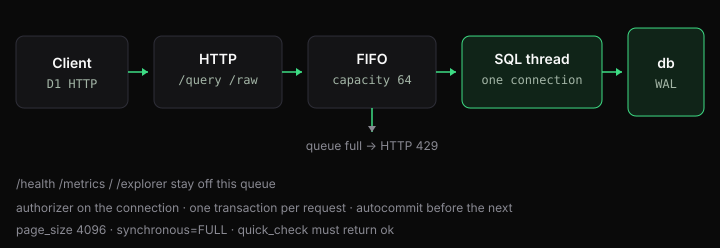
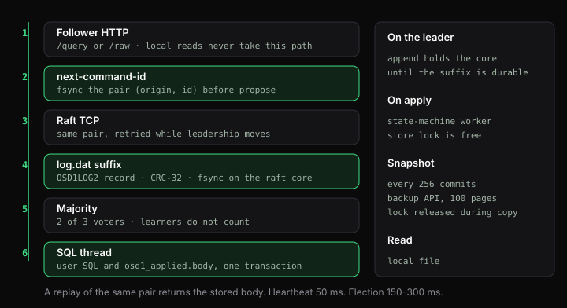
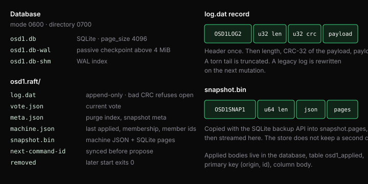

# Architecture

OSD1 is one process. That process owns one SQLite file and one thread that executes SQL. Clients send native SQL over the Cloudflare D1 HTTP shape. Raft, when you turn it on at startup, replicates committed statements. Litestream, when you run it, copies the leader’s file from outside the process.

Three properties hold the design together:

1. One file and one SQL thread. Tokio tasks enqueue work. They do not call SQLite.
2. The HTTP surface matches the installed Cloudflare D1 client (`cloudflare@4.5.0`).
3. Replication is chosen once, at process start. A committed statement replays the same way on every node. Followers serve local reads.

For the lock order, the log record, and idempotent apply, see [Low-level design](low-level.md). For the review of those choices, see [System design](system-design.md).

## Client layer

`POST /accounts/:account_id/d1/database/:database_id/query` and the matching `/raw` route are the only routes that run SQL. They wait on a bounded FIFO. A full queue returns HTTP 429 and does not block. `GET /health`, `GET /metrics`, `GET /`, and `GET /explorer` skip the queue. The explorer pages are unauthenticated HTML. The page sends the bearer token only on `/raw`.

The account id and database id in the path are ignored unless `OSD1_DATABASE_ID` or `OSD1_ROUTES` is set. One process still has one database.

<figure>
  
  <figcaption>Figure 1. Simple mode. Query and raw are the only routes that run SQL.</figcaption>
</figure>

Parameters are bound with the SQLite bind API. The response envelope follows the installed `cloudflare` package. Status codes are on the [overview](index.md#usage).

For more information, see [API examples](api-examples.md) and [SDK compatibility](compatibility.md).

## Distribution layer

Set `OSD1_NODE_ID`, `OSD1_RAFT_LISTEN`, and `OSD1_RAFT_SECRET` to leave simple mode. One process sets `OSD1_RAFT_BOOTSTRAP=1`. A join is a learner unless `OSD1_RAFT_VOTER=1`. Three voters is the cluster. A running process stays in the mode it started in.

Quorum is a majority of the voters. Two voters commit when both have stored the entry. Three voters commit at two. Learners replicate and serve local reads. They do not vote.

A follower reads its own file and sets `served_by_primary` to false. That read can lag the leader. A client that sends back `x-osd1-commit-index` as `x-osd1-min-commit-index` waits until this node’s apply index reaches it. The wait polls `applied_index()` on the metrics watch every 10 ms, in front of the SQL queue, and returns 504 when the deadline passes with the index still behind. `is_leader()` reads that same watch. A read without the header stays on the local file immediately. The D1 SDK does not send the header. `served_by_region` stays `WNAM`. A write takes the path below and returns the log index in `x-osd1-commit-index`. The D1 SDK does not send a command id, so OSD1 allocates one. `/health` stays 200 while the process is up. `ready` is false when commit is more than 32 ahead of apply. A node that is leaving returns 503.

<figure>
  
  <figcaption>Figure 2. The pair <code>(origin node, command id)</code> is applied once. A second delivery returns the stored body.</figcaption>
</figure>

The next id is stored in `<database>.raft/next-command-id` and synced before the command is proposed. On startup the next id is one past the highest id already in that file, in the raft log, and in `osd1_applied` for this node. Node 2’s first write is a different pair from node 1’s first write.

The log is append-only. A legacy log without checksums is rewritten to `OSD1LOG2` on the next mutation. A bad checksum refuses to open the directory. Overlap, purge, and a conflicting delete still rewrite the file. The vote is `vote.json`, synced on its own. `meta.json` moves on purge and on snapshot. `machine.json` keeps the last applied index, the membership, and the member ids. The response map is not in that file.

Apply runs on the state-machine worker. The store lock is released before SQL runs. The SQL thread inserts `(origin, id, idx)` into `osd1_applied`, where `idx` is the raft log index. If that row is new, it runs the user SQL and writes the response into `body` in the same transaction. If the row already has a body, the apply returns that body and rolls the user SQL back. An older row with an empty body returns an empty result and does not run the SQL again. After the log purges an index, `body` is set NULL for rows at or below that index, except a body applied in the last 3 seconds, which stays until a later purge. Those ages are memory on the SQL thread. The row stays, so a later delivery does not run the SQL again.

Raft mode denies `random`, `randomblob`, `date`, `time`, `datetime`, `julianday`, `strftime`, `unixepoch`, `current_date`, `current_time`, and `current_timestamp`, so a committed statement replays the same way on every node. `last_insert_rowid` stays allowed.

Heartbeat is 50 ms. The election timeout is 150–300 ms. The raft core awaits the log append, and that wait includes the fsync of the new suffix. Heartbeat replication itself does not take the log store. On 2026-11-25 a release run of `measure_append_fsync` on an Apple M4 appended 40 blank entries after 5 warmup appends: minimum 2.877 ms, median 3.001 ms, maximum 3.164 ms. That sync sits under the election window on this quiet run. It is not a loaded cluster, so elections under load are still not a settled property.

SQL apply runs on the state-machine worker. OSD1’s store lock is free while the statement runs. openraft’s Adaptor lock stays held for the whole apply, so the next log call on that node waits. A 400 ms apply on an in-memory cluster left the term unchanged.

Every 256 commits the leader copies pages with SQLite’s backup API (`sqlite3_backup_step`, 100 pages at a time) into `snapshot.pages`. That copy holds the SQL thread and does not hold the store lock. The server then streams `OSD1SNAP1`, the machine JSON, and those pages into `snapshot.bin`, fsyncs a temporary file, and renames it into place. A joiner installs that file instead of replaying every statement since the process started. The openraft snapshot buffer is the one copy used to send and install. The store does not keep another.

`OSD1_RAFT_REMOVE=<id>`, with `OSD1_RAFT_JOIN` and the secret, asks the leader to drop that member. Membership changes run one at a time. There is no HTTP membership route. After the change commits, the leader sends raft frame kind 7 to the address it captured before the change. That process writes `<database>.raft/removed`, returns 503 from `/health`, rejects new SQL with `node is leaving the cluster`, finishes SQL it has already accepted (up to 5 seconds), stops HTTP, and exits 0. A later start of the same directory exits 0, so a restart policy does not bring a removed member back. A process that has never been a member is left running.

The process shuts down on SIGINT and SIGTERM.

A client that stops waiting on its own timer can still observe a committed raft write. The SDK does not retry 504. Sending the statement again is a new command. A follower retries one in-flight forward, with the same pair, for a few seconds while leadership moves.

For more information, see [Low-level design](low-level.md), [System design](system-design.md), [Monitoring](monitoring.md), and [Backup and restore](backup-restore.md).

## Storage layer

### The SQL thread

`SqliteWorker` in `crates/osd1-engine` opens the only connection to the live database. Tokio tasks enqueue work. They never call SQLite.

Startup runs, in order, `PRAGMA page_size=4096`, `journal_mode=WAL`, `synchronous=FULL`, `foreign_keys=ON`, `busy_timeout=0`, then `PRAGMA quick_check`. The check must return the string `ok`. Setting `page_size` on a file that already has pages leaves those pages as they are. The authorizer is installed after that setup.

The authorizer is the policy. OSD1 does not accept or reject statements by scanning SQL text. Client `BEGIN`, `COMMIT`, `ROLLBACK`, and `SAVEPOINT` are denied. A simple-mode request, a leader read, and a raft apply each run as one `BEGIN IMMEDIATE` transaction, and the connection is in autocommit before the next request. A follower read does not open a transaction. A writable statement on that path is refused, and `served_by_primary` is false. `ATTACH`, `DETACH`, `writable_schema`, and the durability pragmas `journal_mode`, `synchronous`, `wal_autocheckpoint`, `locking_mode`, `mmap_size`, and `page_size` are denied. `table_info` and `integrity_check` stay allowed.

`sqlite3_progress_handler` runs every 1,000 virtual-machine opcodes. In simple mode, and on a raft read, the handler interrupts the statement when `OSD1_REQUEST_TIMEOUT_MS` has passed. The HTTP status is 504, code 7500, with `x-should-retry: false`. The default deadline is 30 seconds. `0` waits with no deadline. A raft write carries no deadline. It returns when raft accepts or rejects the command.

After a job, if the connection is in autocommit and `osd1.db-wal` is larger than 4 MiB, the thread runs `PRAGMA wal_checkpoint(PASSIVE)`. The same pragma through `/query` returns SQLite error 6, because that request is already inside `BEGIN IMMEDIATE`. `/metrics` reports the main file size. It does not report the WAL.

### Files

<figure>
  
  <figcaption>Figure 3. <code>node1.db</code> uses the directory <code>node1.raft</code>. Restart binds the same node id, the same raft address, and the same database path.</figcaption>
</figure>

A directory that already contains raft state skips bootstrap and skips join. Bind the voters again before expecting a write. One voter cannot form a majority, and the process stays up until the others return.

`state.json` is read when an older directory still has it, and it is not written again. The record layout is on the [low-level design](low-level.md#log-record) page.

### Restore

Stop every node. Restore one database file. Bootstrap one process on that file with a new raft directory. Copy that same file, plus `-wal` and `-shm`, to each other node before any write. Then join. Keep three voters. Leave the old `.raft` directory behind. `scripts/recovery.sh` covers simple mode. The run recorded in [Backup and restore](backup-restore.md) is 6 Nov 2026.

Litestream stays a sidecar of the leader. It is not the commit path. Nodes that missed a generation catch up through the raft log.

### Several databases

One database is one process. `OSD1_ROUTER=1` reads `OSD1_ROUTES` and proxies `/query` and `/raw`. The router does not open SQLite. It copies the bearer token onto the upstream request and returns the upstream status and JSON body. Commit-index headers are read and written by the process that executes SQL. `OSD1_DATABASE_ID` pins a process to one path id. With both unset, the account id and database id in the URL are ignored.

For more information, see [Operations](operations.md) and [Backup and restore](backup-restore.md).

## What this process is

| Piece | Where it lives |
| --- | --- |
| HTTP and the queue | `crates/osd1-http` |
| SQL thread, authorizer, backup, deadline | `crates/osd1-engine` |
| Raft log, vote, snapshots | `crates/osd1-raft` |
| Command ids, apply hook, process lifecycle | `crates/osd1-server` |
| Shared request and response types | `crates/osd1-types` |

The consensus library is openraft 0.9 with `single-term-leader`. SQLite is the bundled library inside rusqlite. The engine calls SQLite’s own backup and progress-handler entry points through that crate. The log checksum is CRC-32 in Rust.
