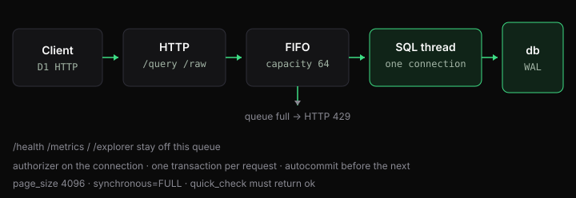

<div class="flex flex-col gap-6">
  <span data-slot="badge" data-variant="default" class="inline-flex w-fit shrink-0 items-center justify-center rounded-full border border-transparent bg-primary px-2 py-0.5 text-xs font-medium whitespace-nowrap text-primary-foreground">One file, one thread</span>
  <h1>The database<br>is a file.</h1>
  <p class="max-w-2xl text-lg text-muted-foreground">OSD1 serves that file over HTTP. You send native SQLite SQL. The request shape matches Cloudflare D1, so the official TypeScript client can call it.</p>
  <div class="grid gap-4 sm:grid-cols-3">
    <div data-slot="card" class="flex flex-col gap-6 rounded-xl border bg-card py-6 text-card-foreground shadow-sm">
      <div data-slot="card-header" class="grid auto-rows-min grid-rows-[auto_auto] items-start gap-2 px-6">
        <div data-slot="card-title" class="text-2xl leading-none font-semibold tabular-nums">111,075</div>
        <div data-slot="card-description" class="text-sm text-muted-foreground">requests/s at 32 clients</div>
      </div>
    </div>
    <div data-slot="card" class="flex flex-col gap-6 rounded-xl border bg-card py-6 text-card-foreground shadow-sm">
      <div data-slot="card-header" class="grid auto-rows-min grid-rows-[auto_auto] items-start gap-2 px-6">
        <div data-slot="card-title" class="text-2xl leading-none font-semibold tabular-nums">6.5 MB</div>
        <div data-slot="card-description" class="text-sm text-muted-foreground">peak resident memory</div>
      </div>
    </div>
    <div data-slot="card" class="flex flex-col gap-6 rounded-xl border bg-card py-6 text-card-foreground shadow-sm">
      <div data-slot="card-header" class="grid auto-rows-min grid-rows-[auto_auto] items-start gap-2 px-6">
        <div data-slot="card-title" class="text-2xl leading-none font-semibold tabular-nums">0.14–0.17 ms</div>
        <div data-slot="card-description" class="text-sm text-muted-foreground">p50, one Python client</div>
      </div>
    </div>
  </div>
  <div class="flex flex-wrap gap-2">
    <a data-slot="button" data-variant="default" data-size="default" class="inline-flex h-9 shrink-0 items-center justify-center rounded-md bg-primary px-4 py-2 text-sm font-medium whitespace-nowrap text-primary-foreground no-underline transition-all outline-none hover:bg-primary/90 focus-visible:border-ring focus-visible:ring-[3px] focus-visible:ring-ring/50" href="benchmark.html">See the run</a>
    <a data-slot="button" data-variant="outline" data-size="default" class="inline-flex h-9 shrink-0 items-center justify-center rounded-md border bg-background px-4 py-2 text-sm font-medium whitespace-nowrap text-foreground no-underline shadow-xs transition-all outline-none hover:bg-accent hover:text-accent-foreground focus-visible:border-ring focus-visible:ring-[3px] focus-visible:ring-ring/50 dark:border-input dark:bg-input/30 dark:hover:bg-input/50" href="https://github.com/SpringWinter-Research/OSD1">Source</a>
  </div>
  
</div>

<div class="mt-8 grid gap-4 md:grid-cols-2">
  <div data-slot="card" class="flex flex-col gap-6 rounded-xl border bg-card py-6 text-card-foreground shadow-sm">
    <div data-slot="card-header" class="grid auto-rows-min grid-rows-[auto_auto] items-start gap-2 px-6">
      <span data-slot="badge" data-variant="outline" class="inline-flex w-fit items-center rounded-full border border-border px-2 py-0.5 text-xs font-medium text-foreground">OSD1</span>
      <div data-slot="card-title" class="text-2xl leading-none font-semibold">One writer.</div>
    </div>
    <div data-slot="card-content" class="px-6 text-sm text-muted-foreground">One SQLite file, one connection, one transaction per request in simple mode, <code>synchronous=FULL</code>. The client already speaks the D1 HTTP API. 111,075 requests/s is where this laptop’s SQL thread filled up.</div>
  </div>
  <div data-slot="card" class="flex flex-col gap-6 rounded-xl border bg-card py-6 text-card-foreground shadow-sm">
    <div data-slot="card-header" class="grid auto-rows-min grid-rows-[auto_auto] items-start gap-2 px-6">
      <span data-slot="badge" data-variant="outline" class="inline-flex w-fit items-center rounded-full border border-border px-2 py-0.5 text-xs font-medium text-foreground">Postgres</span>
      <div data-slot="card-title" class="text-2xl leading-none font-semibold">Many sessions.</div>
    </div>
    <div data-slot="card-content" class="px-6 text-sm text-muted-foreground">Postgres is the server for concurrent sessions, roles, extensions, and its own protocol. Pooling and replication belong to that job. The numbers on this page are the OSD1 run from 6&nbsp;Nov&nbsp;2026.</div>
  </div>
</div>

<section class="mt-10">
  <h2>The path of a request.</h2>
  
  <p class="text-sm text-muted-foreground">One connection. One transaction per request. Raft, checksums, and the file layout are on the <a href="architecture.html">architecture</a> page. The review document is <a href="system-design.html">system design</a>.</p>
</section>

<section class="mt-10">
  <span data-slot="badge" data-variant="outline" class="inline-flex w-fit items-center rounded-full border border-border px-2 py-0.5 text-xs font-medium text-foreground">Same laptop, no HTTP</span>
  <h2>What the file did alone.</h2>
  <div class="mt-4 grid gap-4 sm:grid-cols-3">
    <div data-slot="card" class="flex flex-col gap-6 rounded-xl border bg-card py-6 text-card-foreground shadow-sm">
      <div data-slot="card-header" class="grid auto-rows-min items-start gap-2 px-6">
        <div data-slot="card-title" class="text-2xl leading-none font-semibold tabular-nums">543,065</div>
        <div data-slot="card-description" class="text-sm text-muted-foreground">WAL transactions/s, synchronous=FULL</div>
      </div>
    </div>
    <div data-slot="card" class="flex flex-col gap-6 rounded-xl border bg-card py-6 text-card-foreground shadow-sm">
      <div data-slot="card-header" class="grid auto-rows-min items-start gap-2 px-6">
        <div data-slot="card-title" class="text-2xl leading-none font-semibold tabular-nums">2,516,325</div>
        <div data-slot="card-description" class="text-sm text-muted-foreground">in-memory transactions/s</div>
      </div>
    </div>
    <div data-slot="card" class="flex flex-col gap-6 rounded-xl border bg-card py-6 text-card-foreground shadow-sm">
      <div data-slot="card-header" class="grid auto-rows-min items-start gap-2 px-6">
        <div data-slot="card-title" class="text-2xl leading-none font-semibold tabular-nums">3,447,361</div>
        <div data-slot="card-description" class="text-sm text-muted-foreground">indexed reads/s, one transaction</div>
      </div>
    </div>
  </div>
  <p class="text-sm text-muted-foreground">SQLite only, on the same Apple&nbsp;M4. These are not HTTP requests, and Postgres was not part of the run.</p>
</section>

## Quick start

**1. Start the server**

```bash
docker pull public.ecr.aws/c5l0h3s1/osd1:latest

docker run --rm -p 8080:8080 \
  -e OSD1_API_TOKEN=dev-token \
  -v osd1-data:/data \
  public.ecr.aws/c5l0h3s1/osd1:latest
```

`latest` and `2026-11-06` include `linux/arm64` and `linux/amd64`. The database file is `/data/osd1.db`. To build from the repo instead: `docker compose -f deploy/compose.yml up -d --build`.

**2. Check that it is up**

```bash
curl -sS http://127.0.0.1:8080/health
```

```json
{"ok":true,"ready":true}
```

**3. Run a query**

```bash
curl -sS -H "Authorization: Bearer dev-token" -H "content-type: application/json" \
  -d '{"sql":"SELECT 1 AS n"}' \
  http://127.0.0.1:8080/accounts/a/d1/database/b/query
```

`/query` returns one JSON object per row. `/raw` returns column names and array rows. The ids in the path are ignored unless `OSD1_DATABASE_ID` or `OSD1_ROUTES` is set. One process still has one database. Health does not use the token. While the process is up the status stays 200. In raft mode `ready` is false when apply lags commit by more than 32. A node that is leaving returns 503 and `{"ok":false,"ready":false}`.

From source:

```bash
cargo run -p osd1-server
```

`OSD1_DB_PATH` defaults to `./data/osd1.db` and `OSD1_HTTP_ADDR` defaults to `127.0.0.1:8080`.

## Usage

```js
import Cloudflare from "cloudflare";

const client = new Cloudflare({
  apiToken: "dev-token",
  baseURL: "http://127.0.0.1:8080",
  maxRetries: 0,
});

for await (const row of client.d1.database.query(
  "00000000-0000-0000-0000-000000000001",
  { account_id: "023e105f4ecef8ad9ca31a8372d0c353", sql: "SELECT 1 AS n" },
)) {
  console.log(row);
}
```

`node spike/sdk-compat.mjs` runs this client against a local binary. The last run printed `sdk-compat ok`. Differences from the SDK are listed in [compatibility](compatibility.md).

| Status | Code | Meaning |
| --- | --- | --- |
| 200 | | The SQL ran |
| 400 | 7500 | SQLite or the authorizer rejected it, or the JSON answer is too large |
| 400 | 7400 | Malformed body, SQL, parameter, or `x-osd1-min-commit-index` |
| 401 | 10000 | Missing or wrong bearer token |
| 413 | | Body is over the size limit. SQL does not run |
| 429 | 10001 | The queue is full (`x-should-retry: false`) |
| 504 | 7500 | Timed out. Simple mode and raft reads interrupt the statement at `OSD1_REQUEST_TIMEOUT_MS`. A raft read waiting on `x-osd1-min-commit-index` uses that same deadline. A raft write waits for raft |
| 500 | 7500 | The SQL thread has stopped |
| 503 | 7500 | The node is leaving the cluster. New SQL is not queued. Message `node is leaving the cluster` |

Parameters may be null, text, integers, or finite floats. `BEGIN`, `COMMIT`, `ROLLBACK`, `SAVEPOINT`, `ATTACH`, and `DETACH` are refused. Several statements in one request share one transaction in simple mode, on a leader read, and on a raft apply. A follower read steps its statements with no transaction.

## Features

- One SQLite file, one connection, one thread that runs SQL
- Native SQL, with parameters bound by SQLite
- One transaction per HTTP request in simple mode, on a leader read, and on a raft apply
- A fixed-size queue. Extra requests get 429
- Bearer-token authentication
- A table explorer at `/` and `/explorer`
- `GET /metrics` in Prometheus text format, for Grafana
- Optional Litestream sidecar for backup to S3
- Optional Raft mode: followers serve local reads and forward writes to the leader. A write returns `x-osd1-commit-index`. A read can send it back as `x-osd1-min-commit-index` and wait for this node to apply that far. `/health` stays 200 while the process is up. `ready` is false when apply lags commit by more than 32
- Published images for `linux/arm64` and `linux/amd64`

The read wait uses the metrics watch and the same deadline as the SQL statement. A stored apply body younger than 3 seconds survives a log purge until a later purge. That clock is memory on the SQL thread. Removing a member writes `<database>.raft/removed`, returns 503, finishes SQL already accepted (up to 5 seconds), and then stops HTTP. The byte layout is on the [architecture](architecture.md) page. What to alert on is on the [monitoring](monitoring.md) page.

## Configuration

| Variable | Default | Purpose |
| --- | --- | --- |
| `OSD1_DB_PATH` | `./data/osd1.db` | Database file. The image uses `/data/osd1.db` |
| `OSD1_HTTP_ADDR` | `127.0.0.1:8080` | Listen address. The image uses `0.0.0.0:8080` |
| `OSD1_API_TOKEN` | empty | Bearer token. Empty disables auth |
| `OSD1_QUEUE_CAPACITY` | `64` | Requests allowed to wait |
| `OSD1_MAX_BODY_BYTES` | 1 MiB | Largest request body |
| `OSD1_MAX_RESPONSE_BYTES` | 1 MiB | Largest success JSON |
| `OSD1_REQUEST_TIMEOUT_MS` | `30000` | Deadline for simple mode and for a raft read, including a read that waits on `x-osd1-min-commit-index`. The statement is interrupted. `0` waits without a deadline. A raft write waits for raft |
| `OSD1_SERVED_BY_COLO` | `LOC` | Value copied into result metadata |
| `OSD1_NODE_ID` | unset | Raft node id, a `u64`. Set with the variables below to leave simple mode |
| `OSD1_RAFT_LISTEN` | unset | Raft TCP address, `host:port` |
| `OSD1_RAFT_SECRET` | unset | Shared secret on the raft port |
| `OSD1_RAFT_BOOTSTRAP` | unset | `1` or `true` starts a new cluster. Ignored when `<database>.raft` already has state |
| `OSD1_RAFT_JOIN` | unset | Raft address of a node already in the cluster. Ignored when this node's raft directory already has state |
| `OSD1_RAFT_VOTER` | unset | `1` or `true` makes this join a voter. The default join is a learner |
| `OSD1_RAFT_REMOVE` | unset | Node id to drop. Also set `OSD1_RAFT_JOIN` and `OSD1_RAFT_SECRET`. The caller exits after the call. The removed node returns 503, finishes accepted SQL for up to 5 seconds, then exits. A later start of that database exits too |
| `OSD1_ROUTER` | unset | `1` or `true` serves the route table and does not open a database |
| `OSD1_ROUTES` | unset | File of `database_id http://host:port` lines. Blank lines and `#` comments are skipped |
| `OSD1_DATABASE_ID` | unset | Path id this process serves from its own file |
| `OSD1_LITESTREAM_HEARTBEAT` | unset | File the sidecar touches. `/metrics` then exports `osd1_litestream_last_ok_seconds` |

A directory OSD1 creates is mode `0700`. The database, WAL, shared-memory, and raft files are mode `0600`. The API token is redacted from the startup log. How the files fit together is on the [architecture](architecture.md) page.

## Benchmarks

Apple M4, 6 Nov 2026, release build, loopback. `SELECT 1` over keep-alive HTTP. At 32 clients the rate stopped climbing: the SQL thread was full.

| Clients | Requests/s |
| ---: | ---: |
| 1 | 25,467 |
| 8 | 82,129 |
| 16 | 102,234 |
| 32 | 111,075 |

On the same machine, SQLite with no HTTP did 2,516,325 in-memory transactions/s, 543,065 WAL transactions/s with `synchronous=FULL`, and 3,447,361 indexed reads/s inside one transaction.

A single Python client against four workloads (2,000 calls each, 4,000 indexed rows loaded):



| Workload | p50 | p95 | p99 | Requests/s |
| --- | ---: | ---: | ---: | ---: |
| Read-heavy (95% select) | 0.17 ms | 0.49 ms | 0.78 ms | 2,335 |
| Balanced | 0.16 ms | 0.47 ms | 0.95 ms | 2,554 |
| Write-heavy (90% write) | 0.14 ms | 0.48 ms | 1.64 ms | 2,568 |
| Mixed, with a large scan | 0.16 ms | 0.36 ms | 0.45 ms | 3,413 |

Peak resident memory in that run was 6.5 MB. Full output is on the [benchmark](benchmark.md) page.

## Testing

```bash
cargo test --workspace
node spike/sdk-compat.mjs
./scripts/profiles.sh
```

`cargo test --workspace` passed on 6 Nov 2026: engine 11, HTTP 18, server 1, suite 9, types 5. That run covered SQL, types, transactions, 10/100/500 clients, a full queue, the SDK, process kill, and malformed input.

Docker checks use port 8080. Run them one at a time:

```bash
./scripts/persist.sh          # restart and recreate keep the row
./scripts/tls-check.sh        # TLS terminates at nginx
./scripts/recovery-cases.sh   # missing volume, failed restore
./scripts/recovery.sh         # Litestream restore and integrity check
./scripts/scan.sh             # cargo audit and Trivy
```

`cargo audit` reported no advisories in 77 crates. Trivy reported 225 findings in the Debian base image, including one critical `zlib` CVE. Details are in [testing](testing.md) and the [security scan](security-scan.md).

## Documentation

- [Architecture](architecture.md)
- [System design](system-design.md)
- [API examples](api-examples.md)
- [SDK compatibility](compatibility.md)
- [Operations](operations.md)
- [Monitoring](monitoring.md)
- [Backup and restore](backup-restore.md)
- [Benchmarks](benchmark.md)
- [Testing](testing.md)
- [Security scan](security-scan.md)

## License

[MIT](https://github.com/SpringWinter-Research/OSD1/blob/main/LICENSE)
