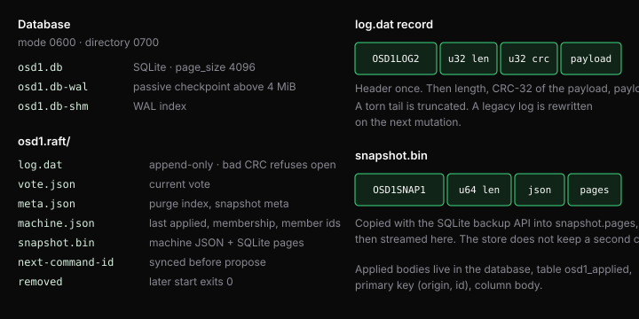

# Low-level design

This page is the call order and the byte layout of one node. The layer picture is [Architecture](architecture.md). The review of the choices, including the failure table, is [System design](system-design.md).

One OS thread, named `osd1-sql`, executes SQL. Tokio worker threads never call SQLite on the live file. The backup API opens a second connection, and that connection is to the destination path.

## Threads

| Thread | What it runs |
| --- | --- |
| Tokio workers | HTTP, the openraft core, the state-machine worker, and the raft TCP listener |
| `osd1-sql` | The only caller of SQLite on `OSD1_DB_PATH` |
| Spawned snapshot task | Page copy through the backup API, after the Adaptor guard is released |

`main` calls `osd1_server::run`. The branch order is removal, then the router, then raft mode when any raft variable is set, then simple mode.

## Locks

Two locks are different guards. A call can hold one while the other is free.

`SqlStore.inner` is OSD1’s `RwLock` around the in-memory log, the durable cursors, and the machine. The openraft Adaptor `RwLock` wraps the storage future. openraft 0.9.25’s adapter provides that lock and provides no parallelism between storage calls on the same node.

<figure>
  
  <figcaption>Figure 1. Green rows hold the Adaptor lock or run on <code>osd1-sql</code>. <code>SqlStore.inner</code> is released before the log fsync and before user SQL.</figcaption>
</figure>

| Call | Adaptor `RwLock` | `SqlStore.inner` | `osd1-sql` |
| --- | --- | --- | --- |
| Allocate `next-command-id` | Free | Free | Free |
| `append_to_log` | Held for the whole future, including the fsync | Write guard for the memory update, dropped before the fsync | Free |
| Apply | Held for the whole apply hook | Free while the statement runs | `execute_idempotent`, one `BEGIN IMMEDIATE` |
| Snapshot page copy | Released before the copy | Free during the copy | Backup API, 100 pages a step |
| `get_current_snapshot` | Held across `fs::read` of `snapshot.bin` | Read guard dropped before the file read | Free |
| `install_snapshot` | Held across `install_main` | Hook runs before any inner write | Drop the connection, replace the file, reopen |
| Leader read | Free | Free | `Job::Execute`, one transaction |
| Follower read | Free | Free | `Job::Read`, no transaction |

The HTTP task allocates `(origin, id)` and syncs `next-command-id` before it proposes. That file is outside both store locks. `RaftExec::forward` keeps the same pair for about 3 seconds: 50 ms when there is no leader, 30 ms after a failed attempt.

`append_to_log` updates the in-memory log under `SqlStore.inner`, drops that guard, and fsyncs the new suffix. The Adaptor write guard stays held for the whole call, and the raft core awaits it. `apply_to_state_machine` on the core only sends the apply command. The state-machine worker runs the hook. It holds the Adaptor guard until `execute_idempotent` returns, so the next log call on that node waits.

`RaftCore::append_to_log` awaits `log_store.append`, so the core task waits for the fsync. Heartbeat replication does not take the log store. The measured suffix fsync on a quiet machine is in [Recorded measurements](system-design.md#recorded-measurements). That run is not a loaded cluster. Elections under load are not a settled property.

Snapshot build runs on a spawned task. The page copy uses the backup API on `osd1-sql` with both locks free. `get_current_snapshot` holds the Adaptor guard while it reads `snapshot.bin` into `Cursor<Vec<u8>>`. `send_snapshot` starts after that guard drops. `install_snapshot` holds the guard across `install_main`.

## Command ids

The idempotency key is `(origin node, command id)`. Each new HTTP request on a node takes the next id from `<database>.raft/next-command-id`. `CommandIds::allocate` writes `id + 1` to a temp file, fsyncs, sets mode `0600`, renames over `next-command-id`, and syncs the directory. That bump is not inside `SqlStore::persist` and does not take the store lock. It runs before `propose` or `forward`.

On startup the floor is `max(raft_max, applied_max) + 1`. `CommandIds::load` then takes `max(file, floor, 1)`. `raft_max` scans this process’s log. `applied_max` is `MAX(id)` from `osd1_applied` for this origin. The key form is `{origin}:{id}`. The scan strips the prefix `{origin}:`, so origin `1` does not consume the key `10:5`.

A follower retries one timed-out forward with the same pair. A client that gives up and sends the statement again gets a new id. That second command can commit even when the first one did. `WRITE_TIMEOUT` is 30 seconds per attempt. `JOIN_TIMEOUT` is 120 seconds. The raft RPC timeout is 800 ms.

A raft write has no server deadline. `AppState.request_timeout` is unset in raft mode, so the HTTP wrapper waits until the executor replies. The read deadline still applies inside `RaftExec`.

## Apply

`execute_idempotent` runs on `osd1-sql`:

1. `BEGIN IMMEDIATE`.
2. `INSERT OR IGNORE INTO osd1_applied (origin, id, idx)`. `idx` is the raft log index. A zero index stores NULL.
3. If the row already existed, read `body`, roll back, and return the stored response. An empty body returns an empty statement list. The user SQL does not run again.
4. If the row is new, run the SQL, write `body`, and commit. A failure before `COMMIT` rolls the insert back with the user SQL.

```sql
CREATE TABLE IF NOT EXISTS osd1_applied (
    origin INTEGER NOT NULL,
    id INTEGER NOT NULL,
    body TEXT,
    idx INTEGER,
    PRIMARY KEY (origin, id)
);
```

`body` is the stored statement list. It is not the D1 HTTP envelope. The wire header `x-osd1-commit-index` is the log index from `client_write`, copied after apply.

After `purge_logs_upto`, a body-horizon hook sets `body` to NULL where `idx` is at or below the purged index. A body applied in the last 3 seconds (`APPLIED_BODY_HOLD`) stays until a later purge. The ages are an in-memory map on the SQL thread. A restart drops the map. A successful snapshot install clears it. The hook ignores a SQL error, including a connection that is already inside a transaction, so the purge still completes and the next purge retries. The row stays. A later delivery of a cleared pair returns an empty result and does not run the SQL again.

## Reads

`RaftExec::read` samples `is_leader()` once from the metrics watch. When the request carries `x-osd1-min-commit-index`, it first polls `applied_index()` on that watch until the index is applied or the read deadline elapses. A missed deadline returns 504 and does not queue SQL. An absent header is left unset. Zero, a non-integer, or non-UTF-8 is HTTP 400, code 7400, message `x-osd1-min-commit-index must be an integer of 1 or more`. Simple mode ignores a well-formed header.

A leader sample enqueues `Job::Execute` (`execute_request`, one transaction). When that response returns, if `is_leader()` is now false, every statement’s `served_by_primary` is set false. The SQL of a sample that was leader still ran as `BEGIN IMMEDIATE`. Any other sample enqueues `Job::Read` (`read_request`, no transaction, `served_by_primary` false). A writable statement on that path is refused with `write must be committed by the leader`.

One SQL thread runs a follower read to completion before the next apply, so the statements of that read see one snapshot of the file. The read is not wrapped in `BEGIN`.

`is_leader()` and `applied_index()` read `raft.metrics()` only. `status()` still uses `with_raft_state` for the commit index, because `RaftMetrics` carries `last_applied` and does not carry a commit index. The strict read does not call `status()`.

## Log record

`log.dat` starts with the 8-byte magic `OSD1LOG2`. Each record is then:

| Field | Width | Meaning |
| --- | --- | --- |
| Length | `u32be` | Payload bytes |
| Checksum | `u32be` | IEEE CRC-32 of the payload (`crc32_ieee`, polynomial `0xEDB88320`) |
| Payload | length | JSON entry |

A bad checksum refuses to open the directory (`raft log checksum`). A torn tail stops the scan, and `load` truncates the file to the last valid byte. A missing or empty file is version 2 with length 0.

`plan_append` advances `log_bytes`, `log_durable_index`, and `log_v2` in memory before the write returns. A failed suffix append restores those three fields and leaves the new entries in the in-memory map, so the next successful append encodes them again. A failed rewrite inside `append_to_log` restores `log_bytes` and `log_durable_index` and clears `log_v2`, so the next append rewrites the file. `append_at` truncates back to the start offset when the written length is past that offset. It syncs the parent directory only when `offset` is 0, which is the create. Later appends fsync the file.

`purge_logs_upto` and `delete_conflict_logs_since` split the in-memory map and then rewrite the file. If `plan_rewrite` or `write_log_job` fails, both put the split entries back and restore the three cursors. Purge also restores `last_purged_log_id`. `flush_meta` and the body-horizon hook run only after that rewrite succeeds. An in-memory store (`dir` is absent) plans no rewrite. A purge or delete on that store still drops the split entries.

`atomic_write` writes `name.tmp`, fsyncs, sets mode `0600`, renames, then opens the parent and `sync_all`. A failure to open the directory or to sync it is ignored.

## Directory

<figure>
  
  <figcaption>Figure 2. <code>node1.db</code> uses <code>node1.raft</code>, mode <code>0700</code>. Files are mode <code>0600</code>.</figcaption>
</figure>

| File | Contents |
| --- | --- |
| `log.dat` | `OSD1LOG2` and the records above. A legacy file has no magic and no CRC. The next mutation rewrites it |
| `vote.json` | The openraft vote. Memory is updated, then the file is fsynced outside `SqlStore.inner` |
| `meta.json` | `last_purged_log_id`, `snapshot_idx`, `snapshot_meta`. `meta_lock` keeps a purge and a snapshot from persisting each other’s fields |
| `machine.json` | `last_applied_log`, `last_membership`, `member_ids`. `seen` and `applied` are not written |
| `snapshot.bin` | Magic `OSD1SNAP1`, `u64le` JSON length, machine JSON, SQLite page bytes |
| `snapshot.pages` | Page copy. Deleted after `snapshot.bin` is durable |
| `next-command-id` | Decimal text of the next id, with a trailing newline |
| `removed` | `1\n`. A later start of that directory exits 0 |
| `state.json` | Legacy state. Read when an older directory still has it. Not written again |

A directory that already contains raft state skips bootstrap and join. The process binds the same node id, the same raft address, and the same database path.

## Snapshot

The snapshot policy is `LogsSinceLast(256)`. The chunk size is 256 KiB. `max_in_snapshot_log_to_keep` is 256. The page copy is `sqlite3_backup_step`, 100 pages at a time, into `snapshot.pages`. The server then streams `OSD1SNAP1`, the machine JSON, and those pages into `snapshot.bin.tmp`, fsyncs, and renames.

`install_main` drops the live connection, writes `.{name}.install`, fsyncs that temp file, deletes `-wal` and `-shm`, renames over the database, restricts the file mode, and then syncs the parent directory. A failure to open the directory or to sync it is ignored, the same way `atomic_write` ignores it. The connection is reopened and the authorizer is installed again. A crash after the file is replaced and before `machine.json` is written is an accepted window: replay uses `osd1_applied` when the row committed.

## Raft frames

Every request frame is `u32be` length, then `u8` kind, `u16be` secret length, secret bytes, and JSON. `MAX_FRAME` is 16 MiB. A secret mismatch drops the connection. The compare checks the length and folds a XOR, so it does not return on the first differing byte.

| Kind | Value | Role |
| --- | --- | --- |
| `KIND_VOTE` | 1 | openraft vote RPC |
| `KIND_APPEND` | 2 | append entries, including heartbeats |
| `KIND_SNAPSHOT` | 3 | install snapshot |
| `KIND_JOIN` | 4 | add learner, or voter when `JoinBody.voter` is true |
| `KIND_WRITE` | 5 | `client_write` of one `SqlCommand` |
| `KIND_REMOVE` | 6 | leader drops a member |
| `KIND_GONE` | 7 | leader tells that member to stop |

The membership address is `{raft_addr}|{http_addr}`. The TCP dial uses the text before `|`.

## What stays open

The failure table in [System design](system-design.md#failure-behavior-and-risks) is the list. The items that are still operational unknowns are elections under load, and the time `install_snapshot` and the `snapshot.bin` read hold the Adaptor lock. Both sit next to an election timeout of 150–300 ms. Those waits are unmeasured on a loaded cluster.
