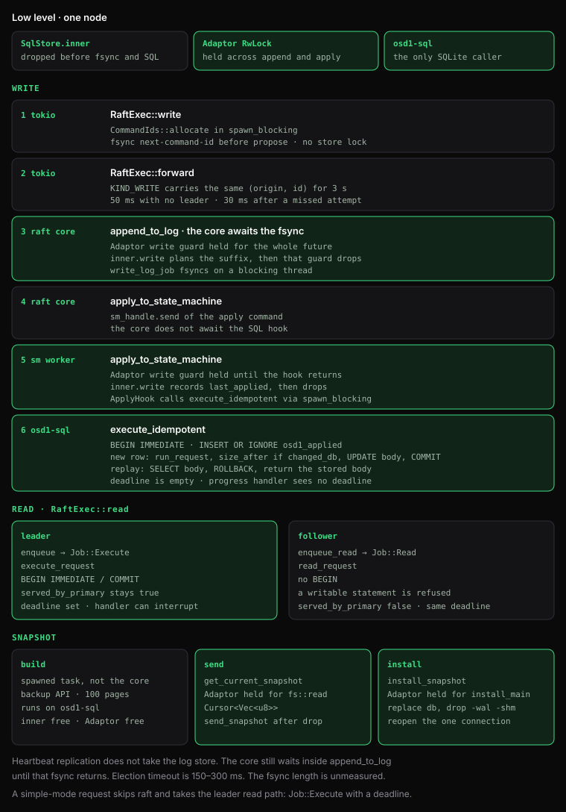

# Low-level design

This page is the call order and the byte layout of one node. The layers are on the [architecture](architecture.md) page. The limits are on the [system design](system-design.md) page.

One OS thread, named `osd1-sql`, executes SQL. Tokio worker threads never call SQLite on the live file. The backup API opens a second connection. That connection is to the destination path.

## Threads

| Thread | What it runs |
| --- | --- |
| Tokio workers | HTTP, the raft core, the state-machine worker, and the raft TCP listener |
| `osd1-sql` | The only caller of SQLite on `OSD1_DB_PATH` |
| Spawned snapshot task | Page copy through the backup API, after the Adaptor lock is released |

`main` calls `osd1_server::run`. The branch order is removal, then the router, then raft mode when any raft variable is set, then simple mode.

## Jobs

| Job | How it is sent | Transaction |
| --- | --- | --- |
| `Execute` | `try_send` | One `BEGIN IMMEDIATE`. A deadline can interrupt it. |
| `Read` | `try_send` | No transaction. A writable statement is refused with `write must be committed by the leader`. |
| `Writes` | `try_send` | Prepare only. No transaction. |
| `ExecuteId` | Blocking `send` | `execute_idempotent`. A full client queue cannot drop this job. |
| `Backup`, `Snapshot`, `Install` | Blocking `send` | Refused when the connection is poisoned or not in autocommit. |
| `MaxApplied` | Blocking `send` | Reads the highest applied id. This runs when autocommit is off, unless the worker is poisoned. |

Startup calls `MaxApplied` before HTTP listens. A passive checkpoint can run after a job. The size rule is on the [architecture](architecture.md) page.

## Locks

Two locks are different. A call can hold one while the other is free.

`SqlStore.inner` is the lock around the in-memory log, the durable cursors, and the machine. The Adaptor lock wraps each storage call. Storage calls on the same node do not run in parallel.

<figure>
  
  <figcaption>Figure 1. Green rows hold the Adaptor lock or run on <code>osd1-sql</code>. <code>SqlStore.inner</code> is released before the log sync and before user SQL.</figcaption>
</figure>

| Call | Adaptor lock | `SqlStore.inner` | `osd1-sql` |
| --- | --- | --- | --- |
| Allocate `next-command-id` | Free | Free | Free |
| `append_to_log` | Held for the whole call, and for the sync | Write guard for the memory update. Dropped before the sync | Free |
| Apply | Held for the whole apply | Free while the statement runs | `execute_idempotent`, one `BEGIN IMMEDIATE` |
| Snapshot page copy | Released before the copy | Free during the copy | Backup API, 100 pages a step |
| `get_current_snapshot` | Held across the read of `snapshot.bin` | Read guard dropped before the file read | Free |
| `install_snapshot` | Held across `install_main` | The hook runs before any inner write | Drop the connection, replace the file, reopen |
| Leader read | Free | Free | `Job::Execute`, one transaction |
| Follower read | Free | Free | `Job::Read`, no transaction |

The HTTP task allocates `(origin, id)` and syncs `next-command-id` before it proposes. That file is outside both store locks. `forward` keeps the same pair for about 3 seconds. It sleeps 50 ms when there is no leader. It sleeps 30 ms after a failed attempt.

`append_to_log` updates the in-memory log under `SqlStore.inner`. It drops that guard and syncs the new suffix. The Adaptor lock stays held for the whole call. The raft core waits for that call. The core sends apply and does not wait for SQL. The state-machine worker runs the hook. It holds the Adaptor lock until `execute_idempotent` returns. The next log call on that node waits.

Heartbeat replication does not take the log store. The quiet suffix sync is in [What can go wrong](system-design.md#what-can-go-wrong). That run is not a loaded cluster. Elections under load are unmeasured.

The heartbeat interval is 50 ms. The election timeout is 150 ms to 300 ms.

Snapshot build runs on a spawned task. The page copy uses the backup API on `osd1-sql`. Both locks are free during that copy. `get_current_snapshot` holds the Adaptor lock while it reads `snapshot.bin` into one buffer. `send_snapshot` starts after that lock drops. `install_snapshot` holds the lock across `install_main`.

## Command ids

The idempotency key is `(origin node, command id)`. Each new HTTP request on a node takes the next id from `<database>.raft/next-command-id`.

`CommandIds::allocate` holds a mutex. It writes `id + 1` to a temp file, syncs that file, sets mode `0600`, renames it over `next-command-id`, and syncs the directory. Then it advances the in-memory id. That bump is not inside the raft store lock. It runs before `propose` or `forward`.

On startup the floor is `max(raft_max, applied_max) + 1`. `CommandIds::load` then takes `max(file, floor, 1)`. `raft_max` scans the log of this process. `applied_max` is `MAX(id)` from `osd1_applied` for this origin. The key form is `{origin}:{id}`. The scan strips the prefix `{origin}:`, so origin `1` does not consume the key `10:5`.

A follower retries one timed-out forward with the same pair. A client that gives up and sends the statement again gets a new id. That second command can commit even when the first one did. `WRITE_TIMEOUT` is 30 seconds for each attempt. One `propose` can wait that long. `JOIN_TIMEOUT` is 120 seconds. The raft RPC timeout is 800 ms.

A raft write has no server deadline. `AppState.request_timeout` is unset in raft mode. The HTTP wrapper waits until the executor replies. The read deadline still applies inside `RaftExec`.

## Apply

`execute_idempotent` runs on `osd1-sql`:

1. Start `BEGIN IMMEDIATE`.
2. Run `INSERT OR IGNORE INTO osd1_applied (origin, id, idx)`. `idx` is the raft log index. A zero index stores NULL.
3. If the row already existed, read `body`, roll back, and return the stored response. An empty body returns an empty statement list. The user SQL does not run again.
4. If the row is new, run the SQL, write `body`, and commit. A failure before `COMMIT` rolls the insert back with the user SQL.

```sql
CREATE TABLE IF NOT EXISTS osd1_applied (
    origin INTEGER NOT NULL,
    id INTEGER NOT NULL,
    body TEXT,
    idx INTEGER,
    PRIMARY KEY (origin, id)
);
```

`body` is the stored statement list. It is not the D1 HTTP envelope. The response header `x-osd1-commit-index` is the log index from `client_write`. OSD1 copies it after apply. The header is not a D1 `meta` field.

An old table with no `body` column gets `ADD COLUMN body TEXT`. A table with no `idx` column gets `ADD COLUMN idx INTEGER`.

After `purge_logs_upto`, a hook sets `body` to NULL where `idx` is at or below the purged index. A body applied in the last 3 seconds (`APPLIED_BODY_HOLD`) stays until a later purge. The ages are an in-memory map on the SQL thread. A restart drops the map. A successful snapshot install clears the map. The hook ignores a SQL error. It also ignores a connection that is already inside a transaction. The purge still completes. The next purge tries again. The row stays. A later delivery of a cleared pair returns an empty result and does not run the SQL again.

On a durable store, apply always calls the hook for a normal entry. The `INSERT OR IGNORE` is the duplicate check. An in-memory store can skip the hook when it has already seen the pair.

## Reads

`RaftExec::read` samples `is_leader()` once from the metrics watch. When the request has `x-osd1-min-commit-index`, it first polls `applied_index()` until that index is applied or the read deadline ends. A missed deadline returns HTTP 504 and does not queue SQL. An absent header stays unset. Zero, a non-integer, or non-UTF-8 is HTTP 400, code 7400. The message is `x-osd1-min-commit-index must be an integer of 1 or more`. Simple mode ignores a well-formed header.

A leader sample enqueues `Job::Execute`. That job is one transaction. When the response returns, if `is_leader()` is now false, every statement gets `served_by_primary` false. The SQL of a sample that was leader still ran as `BEGIN IMMEDIATE`. Any other sample enqueues `Job::Read`. That job has no transaction and sets `served_by_primary` false. A writable statement on that path is refused with `write must be committed by the leader`.

One SQL thread runs a follower read to completion before the next apply. The statements of that read see one state of the file. The read is not wrapped in `BEGIN`.

`is_leader()` and `applied_index()` read the metrics watch only. The commit index still comes from raft state, because the metrics watch has `last_applied` and does not have a commit index. The strict read does not call that state path.

## Log record

`log.dat` starts with the 8-byte magic `OSD1LOG2`. Each record is then:

| Field | Width | Meaning |
| --- | --- | --- |
| Length | `u32be` | Payload bytes |
| Checksum | `u32be` | IEEE CRC-32 of the payload. Polynomial `0xEDB88320` |
| Payload | length | JSON entry |

A bad checksum refuses to open the directory. The message is `raft log checksum`. A torn tail stops the scan. `load` truncates the file to the last valid byte. A missing or empty file is version 2 with length 0.

`plan_append` advances `log_bytes`, `log_durable_index`, and `log_v2` in memory before the write returns. A failed suffix append restores those three fields. The new entries stay in the in-memory map, so the next successful append encodes them again. A failed rewrite restores `log_bytes` and `log_durable_index` and clears `log_v2`. The next append rewrites the file. `append_at` truncates back to the start offset when the written length is past that offset. It syncs the parent directory only when `offset` is 0. That is the create. Later appends sync the file.

`purge_logs_upto` and `delete_conflict_logs_since` split the in-memory map and then rewrite the file. If the plan or the write fails, both put the split entries back and restore the three cursors. Purge also restores `last_purged_log_id`. `flush_meta` and the body-horizon hook run only after that rewrite succeeds. An in-memory store plans no rewrite. A purge or delete on that store still drops the split entries.

`atomic_write` writes `name.tmp`, syncs it, sets mode `0600`, renames it, then opens the parent and syncs the directory. A failure to open or sync the directory is ignored.

## Directory

<figure>
  
  <figcaption>Figure 2. <code>node1.db</code> uses <code>node1.raft</code>, mode <code>0700</code>. Files are mode <code>0600</code>.</figcaption>
</figure>

| File | Contents |
| --- | --- |
| `log.dat` | `OSD1LOG2` and the records above. A legacy file has no magic and no CRC. The next mutation rewrites it |
| `vote.json` | The raft vote. Memory is updated, then the file is synced outside `SqlStore.inner` |
| `meta.json` | `last_purged_log_id`, `snapshot_idx`, `snapshot_meta`. A lock keeps a purge and a snapshot from writing each other's fields |
| `machine.json` | `last_applied_log`, `last_membership`, `member_ids`. `seen` and `applied` are not written |
| `snapshot.bin` | Magic `OSD1SNAP1`, `u64le` JSON length, machine JSON, SQLite page bytes |
| `snapshot.pages` | Page copy. Deleted after `snapshot.bin` is durable |
| `next-command-id` | Decimal text of the next id, plus a newline |
| `removed` | `1\n`. A later start of that directory exits 0 |
| `state.json` | Legacy state. Read when an older directory still has it. Not written again |

A directory that already contains raft state skips bootstrap and join. The process binds the same node id, the same raft address, and the same database path. `removed` is checked before the store opens.

## Snapshot

The snapshot policy is `LogsSinceLast(256)`. The chunk size is 256 KiB. `max_in_snapshot_log_to_keep` is 256. The page copy is the SQLite backup API, 100 pages at a time, into `snapshot.pages`. The server then writes `OSD1SNAP1`, the machine JSON, and those pages into `snapshot.bin.tmp`, syncs, and renames.

`install_main` drops the live connection. It writes `.{name}.install`, syncs that temp file, deletes `-wal` and `-shm`, renames over the database, and restricts the file mode. It then syncs the parent directory. A failure to open or sync that directory is ignored. The connection is opened again. The authorizer is installed again.

A crash after the file is replaced, and before `machine.json` is written, is an accepted window. Replay uses `osd1_applied` when the row committed.

## Raft frames

Every request frame is `u32be` length, then `u8` kind, `u16be` secret length, secret bytes, and JSON. `MAX_FRAME` is 16 MiB. A secret mismatch drops the connection. The compare checks the length and folds a XOR. It does not return on the first different byte.

| Kind | Value | Role |
| --- | --- | --- |
| `KIND_VOTE` | 1 | Vote RPC |
| `KIND_APPEND` | 2 | Append entries and heartbeats |
| `KIND_SNAPSHOT` | 3 | Install snapshot |
| `KIND_JOIN` | 4 | Add a learner, or a voter when `JoinBody.voter` is true |
| `KIND_WRITE` | 5 | Client write of one SQL command |
| `KIND_REMOVE` | 6 | Leader drops a member |
| `KIND_GONE` | 7 | Leader tells that member to stop |

The membership address is `{raft_addr}|{http_addr}`. The TCP dial uses the text before `|`.

## What stays open

The risk list is [What can go wrong](system-design.md#what-can-go-wrong). Two items are still unmeasured on a loaded cluster. One is elections while the log sync or SQL apply is slow. The other is the time that snapshot install and the `snapshot.bin` read hold the Adaptor lock. The election timeout beside those waits is 150 ms to 300 ms.
