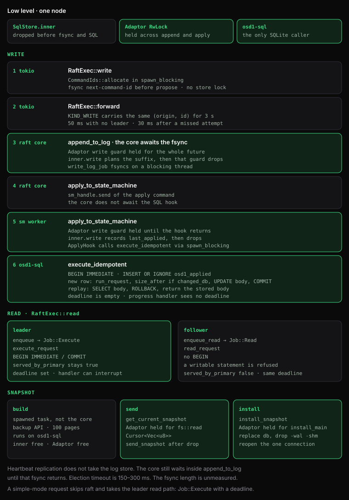
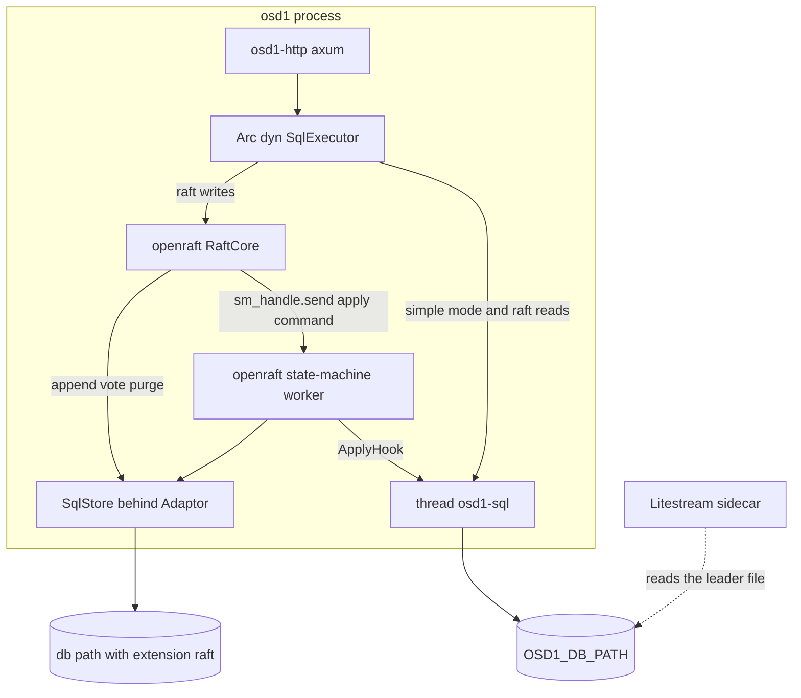
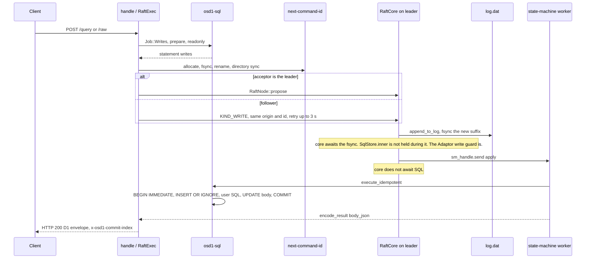
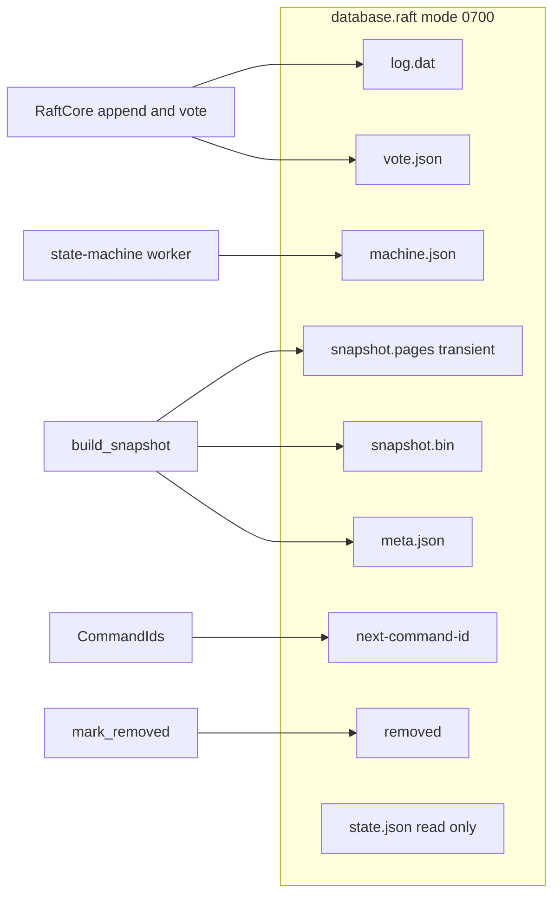

# OSD1 as-built system design

| | |
| --- | --- |
| Author | OSD1 |
| Date | 2026-11-25 |
| Status | As-built |
| Binary | `osd1` (`crates/osd1-server`, package `osd1-server` 0.1.0) |
| Consensus library | openraft 0.9.25, features `serde` and `single-term-leader`. `storage-v2` is off |

This document describes the system that is in the tree. It is a review artifact for a database engineer. It does not propose new mechanisms.

Read [Architecture](architecture.md) for the three layers: the HTTP client, raft distribution, and the SQL file. Read [Low-level design](low-level.md) for the locks, the log record, and `execute_idempotent`. This page is the as-built review of those choices.

<figure>
  
  <figcaption>Figure 1. Locks and threads on one node. The call order is on the <a href="low-level.md">low-level design</a> page.</figcaption>
</figure>

## Overview

OSD1 is one SQLite database file behind an HTTP API that the Cloudflare TypeScript SDK (`cloudflare@4.5.0`) can call. One OS process owns one file at `OSD1_DB_PATH`. One thread, named `osd1-sql`, executes SQL on the one connection to that file. HTTP requests wait on a bounded FIFO. A simple-mode request, a leader read, and an idempotent apply are each one transaction. A follower local read steps its statements with no transaction. Authorization is the SQLite authorizer callback.

Simple mode is the default. It calls `execute_request` for every accepted statement and never opens a Raft log. Raft mode is selected once, at process start, when `OSD1_NODE_ID`, `OSD1_RAFT_LISTEN`, and `OSD1_RAFT_SECRET` are set. One process bootstraps (`OSD1_RAFT_BOOTSTRAP=1`). Other processes join (`OSD1_RAFT_JOIN`). A join is a learner unless `OSD1_RAFT_VOTER=1`. The operational cluster is three voters. Quorum is a majority of the current voter set: two voters commit when both have stored the entry, three voters commit at two. Learners replicate and serve local reads. They sit outside the quorum count.

The workspace is five crates. `osd1-engine` implements `SqlExecutor` from `osd1-types`. `osd1-http` depends only on `osd1-types` and receives `Arc<dyn SqlExecutor>`. `osd1-server` wires the worker to the axum router and, in raft mode, to `osd1-raft`. `osd1-raft` is openraft 0.9 behind `openraft::storage::Adaptor`. Litestream is a sidecar process. It is not linked into `osd1`.

## Background and motivation

The client already speaks the D1 REST shape: `POST /accounts/:account_id/d1/database/:database_id/query` and the matching `/raw` route, with a bearer token and `{"sql","params"}`. OSD1 keeps that envelope and runs the SQL on a single bundled SQLite (rusqlite 0.32, feature `bundled` at the workspace, plus `hooks` and `backup` on the engine crate only). The on-disk SQLite format is upstream SQLite's.

One connection and one thread make the transaction boundary, the authorizer, and the WAL checkpoint obvious. A pool would add a second connection to the live file and a second place where `BEGIN` could be issued. The queue bound makes overload visible as HTTP 429 instead of an unbounded wait. Raft mode exists so a second and third process can hold the same committed statements. The raft log is the replication path. Litestream copies the leader's database file for restore. It does not vote and it does not acknowledge a commit.

## Goals and non-goals

### Goals

- Serve the D1 `/query` and `/raw` envelopes the installed SDK accepts.
- Keep one live connection and one SQL thread. A simple-mode request, a leader read, and an idempotent apply are each one transaction. A follower local read steps its statements with no transaction.
- Bound the queue. A full queue returns HTTP 429 and leaves the caller.
- Authorize with the SQLite authorizer. Bind parameters with the SQLite bind API.
- In raft mode, replicate a committed statement so every node replays the same SQL, and let a follower serve a local read.
- Persist the raft log, the vote, the membership, and the next command id beside the database, and reload them on restart.
- Ship a SQLite page copy in a snapshot so a joiner installs pages once a snapshot exists.
- Expose Prometheus text on `GET /metrics` with a fixed label set.
- Shut the process down on SIGINT and SIGTERM.

### Non-goals

- Blocking every raft read until it matches the leader. A read waits only when the client sends `x-osd1-min-commit-index`. A read without that header can be stale during a partition. `served_by_region` stays `WNAM`. The D1 SDK does not send the header.
- A WAL-size Prometheus gauge.
- A kill -9 crash matrix.
- Deleting the `DiskState` / `state.json` loader.
- Deleting unused dependencies, including the workspace dependency `tracing-subscriber`.
- Removing the duplicate status table between `README.md` and `docs/index.md`.
- A connection pool, a second connection to the live database, an HTTP membership API, openraft 0.10, the `storage-v2` feature, `generic-snapshot-data`, `VACUUM INTO` snapshots, or folding command-id allocation into the raft store lock.
- Deleting `osd1_applied` rows, or clearing a body before its log index is purged. After `purge_logs_upto`, `body` is set NULL where `idx` is at or below that index, except a body applied in the last 3 seconds, which stays until a later purge. The `(origin, id)` row stays, so a replay of a cleared body returns an empty result. Rows with a NULL `idx` keep their body. Clearing a body only after every voter has installed a snapshot is still deferred.
- Changing SQLite's on-disk format.

## Key decisions

1. **One SQL thread.** `SqliteWorker::start` spawns a thread named `osd1-sql`. Tokio tasks enqueue `Job` values. The thread owns the `Connection` opened in `worker_main`.
2. **The transaction follows the job.** A simple-mode request, a leader read, and an idempotent apply each run as one `BEGIN IMMEDIATE` / `COMMIT` through `execute_request` or `execute_idempotent`. `RaftExec::read` chooses the job from one `is_leader()` sample. That sample reads the metrics watch (`ServerState::Leader`). A leader sample calls `enqueue` → `Job::Execute` → `execute_request`. When the response returns, if `is_leader()` is now false, every statement's `served_by_primary` is set false. The SQL of a sample that was leader still ran as `BEGIN IMMEDIATE`. Any other sample calls `enqueue_read` → `Job::Read` → `read_request`: statements are stepped with no transaction, `served_by_primary` is set false, and a statement SQLite marks writable is refused with `write must be committed by the leader`. A follower local read can be stale during a partition. A read that sends `x-osd1-min-commit-index` waits until `applied_index()` on the same watch reaches that value, inside the read deadline, before SQL is queued. The wait polls every 10 ms. The authorizer denies client `Transaction` and `Savepoint` (`DENY_TRANSACTION = 4`, message `client transactions are not allowed`). The connection is back in autocommit before the next job, or the worker is poisoned with `SqlError::TransactionLeftOpen`.
3. **Authorizer, not a SQL scanner.** `install_authorizer` registers rusqlite's `authorizer` callback. Acceptance and rejection go through `deny_context`.
4. **Bounded `sync_channel`.** Capacity defaults to 64 (`OSD1_QUEUE_CAPACITY`). `try_send` failure is `EnqueueResult::Full`, which the HTTP layer maps to 429 with `x-should-retry: false`. The job running on the SQL thread has already been received, so it sits outside the channel bound. `osd1_sql_inflight` can read one higher than `osd1_sql_queue_capacity`.
5. **WAL, `synchronous=FULL`, `busy_timeout=0`.** `prepare_connection` sets those before any client SQL, then requires `PRAGMA quick_check` to return the single string `ok`. `rusqlite::query_row` fails the open if `quick_check` returns more than one row.
6. **Raft is a startup choice.** `run` in `crates/osd1-server/src/lib.rs` branches once. A running process stays in the mode it started in.
7. **openraft 0.9.25 with `single-term-leader`.** The workspace comment records why: 0.10 is alpha, and `single-term-leader` is the Raft paper's rule that a term has at most one leader. Storage is the 0.9 `RaftStorage` trait behind `Adaptor`. `SqlStore::new` (directory `None`) remains for the openraft store suite and the in-process tests. `SqlStore::open` is the durable store.
8. **Append-only checksummed log.** `log.dat` gains a suffix on a normal append. Overlap, purge, conflict deletion, and a legacy upgrade rewrite the file. See Alternatives.
9. **Command identity is `(origin node, id)`.** Each HTTP write on a node allocates a new id and syncs `next-command-id` before propose. The state machine applies that pair once. The D1 SDK sends no id.
10. **Idempotent results live in `osd1_applied`.** The row and the user SQL commit in one transaction. The row stores `idx`, the raft log index of that apply. After that index is purged, `body` is set NULL and the row remains. A body applied in the last 3 seconds stays until a later purge. Those ages are memory on the SQL thread. `machine.json` keeps `last_applied_log`, `last_membership`, and `member_ids`. `seen` and `applied` are `#[serde(skip)]`.
11. **Snapshots use SQLite's backup API.** `backup_database` calls `Connection::backup`, which in rusqlite 0.32.1 steps 100 pages and opens a connection to the destination path. The live file keeps the connection from `worker_main`. Page bytes are streamed into `snapshot.bin`. `StoreInner` keeps snapshot bytes only when `dir` is `None` (`memory_snapshot`).
12. **openraft `SnapshotData` stays `Cursor<Vec<u8>>`.** `begin_receiving_snapshot` returns `Box<Cursor<Vec<u8>>>`. One `Vec` exists while a snapshot is sent or installed, because that is the openraft snapshot type this binary uses.
13. **Membership changes are serialized, and removal is a raft frame.** `RaftNode.membership` is a `Mutex`. `OSD1_RAFT_REMOVE` calls `remove_member` and exits. There is no HTTP membership route. After a successful removal the leader sends `KIND_GONE` (7) to the address captured before the change.
14. **Raft writes wait for raft.** In raft mode `start_node` sets `AppState.request_timeout = None`. `RaftExec::write` allocates an id and waits until propose or forward accepts or rejects. `RaftExec::read` still applies `OSD1_REQUEST_TIMEOUT_MS`. A read that sends `x-osd1-min-commit-index` polls `applied_index()` on the metrics watch inside that same deadline. A successful write returns the log index in `x-osd1-commit-index`. A client that gives up on its own timer can observe a committed write. Fixing that requires a client idempotency key, which the SDK does not send.
15. **Serde features `derive` and `rc`.** `StatementMeta` holds `Arc<str>`. `StatementResult.columns` is `Arc<[String]>`.

## As-built design

### Process shape



`main` calls `osd1_server::run`. The branch order is:

1. `OSD1_RAFT_REMOVE` set: `remove_from_cluster` dials `OSD1_RAFT_JOIN` with `OSD1_RAFT_SECRET`, sends `KIND_REMOVE`, prints a line, and returns. The database stays closed.
2. `OSD1_ROUTER=1` or `true`: `run_router`. SQLite stays closed. `OSD1_ROUTES` is required.
3. Any of `OSD1_NODE_ID`, `OSD1_RAFT_LISTEN`, `OSD1_RAFT_SECRET`, `OSD1_RAFT_JOIN`, `OSD1_RAFT_BOOTSTRAP`, `OSD1_RAFT_VOTER`: raft mode via `start_node`. `raft_configured` also tests `OSD1_RAFT_REMOVE`. `run` has already returned from step 1 when that variable is set, so removal never reaches `start_node`.
4. Otherwise `run_simple`.

`wait_for_shutdown` waits on `tokio::signal::ctrl_c` and, on Unix, on `SignalKind::terminate`. Simple mode passes that future to `axum::serve(...).with_graceful_shutdown`. Raft mode uses the same future inside `RunningNode::until_stop`, raced with the removal watch. This document records the wiring. A SIGTERM delivered to a live process has not been exercised as an operations drill for this write-up.

Startup logs go through `redact`, which replaces `OSD1_API_TOKEN` with `[redacted]` when the token is non-empty.

Default environment, from `run_simple` and `NodeConfig::new`:

| Variable | Default |
| --- | --- |
| `OSD1_DB_PATH` | `./data/osd1.db` (image: `/data/osd1.db`) |
| `OSD1_HTTP_ADDR` | `127.0.0.1:8080` (image: `0.0.0.0:8080`) |
| `OSD1_API_TOKEN` | empty, which leaves `/query` and `/raw` open |
| `OSD1_QUEUE_CAPACITY` | 64 |
| `OSD1_MAX_BODY_BYTES` | 1 MiB |
| `OSD1_MAX_RESPONSE_BYTES` | 1 MiB |
| `OSD1_REQUEST_TIMEOUT_MS` | 30000. `0` means wait with no deadline |
| `OSD1_SERVED_BY_COLO` | `LOC` |

The image (`deploy/Dockerfile`) builds `osd1` with the release profile (`lto = "thin"`, `codegen-units = 1`), runs as uid 10001, and creates `/data` at mode `0700`. `deploy/compose.yml` publishes port 8080 and mounts a volume at `/data`.

### HTTP surface

`osd1_http::router` registers:

| Method and path | Auth | SQL |
| --- | --- | --- |
| `GET /`, `GET /explorer` | none | none. Static HTML, route label `explorer` |
| `GET /health` | none | none. While the process is up the status is 200 and the body is `{"ok":true,"ready":true}`. `ready` is false when `osd1_raft_apply_lag` is above 32. Simple mode reports `ready` true and does not export the raft gauges. A node that is leaving returns 503 and `{"ok":false,"ready":false}` |
| `GET /metrics` | none | none. Prometheus text `text/plain; version=0.0.4` |
| `POST /accounts/{account_id}/d1/database/{database_id}/query` | bearer if `OSD1_API_TOKEN` is set | one request, object rows |
| `POST .../raw` | same | one request, `{columns, rows}` |

`route_label` in `crates/osd1-http/src/metrics.rs` returns `explorer` for `/` and `/explorer`. `docs/monitoring.md` says `route` is `health`, `metrics`, `query`, `raw`, `explorer`, or `other`, and that `/` and `/explorer` use `explorer`. The code is the source of the label.

Path `account_id` and `database_id` select a database only when `local_database_id` or `routes` is set (`OSD1_DATABASE_ID`, `OSD1_ROUTES`). With both empty, `route_target` returns `Target::Local` for every id.

The explorer page (`crates/osd1-http/static/explorer.html`) posts to `/accounts/local/d1/database/local/raw`. It sends `Authorization: Bearer` only from that `raw()` function, and it stores the token under `osd1.token` in browser storage.

Envelope on success:

```json
{"success": true, "errors": [], "messages": [], "result": [ ... ]}
```

`/query` maps each row through `row_to_object`. `/raw` uses `RawResults`. Metadata uses the SDK field names: `changed_db`, `changes`, `duration`, `last_row_id`, `rows_read`, `rows_written`, `served_by_colo`, `served_by_primary`, `served_by_region`, `size_after`, and `timings.sql_duration_ms`. `duration` and `timings.sql_duration_ms` are both the milliseconds `run_statement` measured on the SQL thread. Queue wait is outside that number. `rows_read` is the number of rows returned. `changes` is the delta of `sqlite3_total_changes` for that statement. `changed_db` is true when that delta is non-zero or the authorizer saw a schema action.

Error mapping in `osd1-http`:

| HTTP | Code | When |
| --- | --- | --- |
| 200 | | SQL finished and the encoded envelope fits |
| 400 | 7500 `ERROR_SQL` | `SqlError` other than queue full, shutdown, or timeout, including authorizer denials. Also a success body over `OSD1_MAX_RESPONSE_BYTES` |
| 400 | 7400 `ERROR_BAD_REQUEST` | Malformed JSON, missing or empty `sql`, bad parameter, or a zero or non-integer `x-osd1-min-commit-index`. An absent header is left unset. Whitespace around `sql` is kept |
| 401 | 10000 `ERROR_UNAUTHORIZED` | Bearer missing or wrong |
| 404 | 7400 | `database_id` matches neither `OSD1_DATABASE_ID` nor `OSD1_ROUTES` |
| 413 | | axum `DefaultBodyLimit`. SQL is not queued |
| 429 | 10001 `ERROR_QUEUE_FULL` | `x-should-retry: false` |
| 504 | 7500 | `SqlError::TimedOut`. `x-should-retry: false`. Message `sql request timed out` |
| 500 | 7500 | Worker shut down |
| 503 | 7500 | Node is leaving. Message `node is leaving the cluster`. The request is returned before authorize, is not queued, and does not increment `osd1_sql_requests_total` |
| 502 | 7400 | Router upstream failure |

Parameters are JSON null, string, integer, or finite float (`parse_params`). Booleans, objects, and arrays are rejected. Blob result cells return `SqlError::Sqlite` with message `blob results are not supported`.

`handle` sets `SqlRequest.deadline` to `Instant::now() + request_timeout` when the timeout is `Some`. `deadline` is not serialized. `wait_for_sql` also wraps the oneshot in `tokio::time::timeout` for the same duration. Raft mode clears `AppState.request_timeout`, so that HTTP wrapper waits until the executor replies. The read deadline is applied inside `RaftExec`.

### SQL thread

`Job` values:

| Job | Queue send | Deadline wrapper | Transaction |
| --- | --- | --- | --- |
| `Execute` | `try_send` | `run_with_deadline` | `BEGIN IMMEDIATE` / `COMMIT` via `execute_request` |
| `Read` | `try_send` | `run_with_deadline` | none. A statement SQLite marks writable is refused with `write must be committed by the leader` and is not stepped |
| `Writes` | `try_send` | none | none. Prepare only, `readonly()` |
| `ExecuteId` | blocking `send` | `run_with_deadline` if `deadline` is set | `execute_idempotent` |
| `Backup`, `Snapshot`, `Install` | blocking `send` | none | refused with `TransactionLeftOpen` when the connection is poisoned or not in autocommit |
| `MaxApplied` | blocking `send` | none | `TransactionLeftOpen` only when the worker is poisoned. Otherwise `max_applied_origin` runs even when autocommit is off. Startup calls `max_applied_id` before HTTP |

`execute_idempotent` on `SqliteWorker` uses blocking `send` so a full client queue cannot drop a committed raft command. `ApplyHook` in the server calls it from `spawn_blocking`.

After every job, if the worker is not poisoned, `checkpoint_if_wal_is_large` runs when the connection is in autocommit and `{path}-wal` is larger than `WAL_CHECKPOINT_BYTES` (4 MiB). It executes `PRAGMA wal_checkpoint(PASSIVE)` under `allow_internal` and ignores the error. `busy_timeout` is 0, so a busy checkpoint returns immediately. `PRAGMA wal_checkpoint` cannot be sent through `/query`: the request is already inside `BEGIN IMMEDIATE`, and SQLite returns extended code 6 (locked). There is no WAL gauge.

`install_progress` registers rusqlite's `progress_handler` (the `hooks` feature) every 1,000 opcodes. The callback reads the thread-local `SQL_DEADLINE`. It returns true when the cell is set and `Instant::now() >= deadline`, which interrupts the statement. `map_sqlite_error` maps an extended code whose low byte is `SQLITE_INTERRUPT` (9) to `SqlError::TimedOut` only when that cell is set and the deadline has passed, then clears the cell so the following `ROLLBACK` is not itself interrupted. A deadline that is already past returns `TimedOut` before the statement runs. `install_progress` runs again in `reopen_connection` after a snapshot install.

`prepare_connection`, in order:

```sql
PRAGMA page_size=4096;
PRAGMA journal_mode=WAL;
PRAGMA synchronous=FULL;
PRAGMA foreign_keys=ON;
PRAGMA busy_timeout=0;
PRAGMA quick_check;
```

SQLite applies `page_size` when the database is created empty. An existing file keeps the page size it was created with. `journal_mode`, `synchronous`, and `foreign_keys` are applied on every open. `foreign_keys` is a connection setting. The prepared-statement cache capacity is 32. A column-name cache holds 16 entries (`COLUMN_CACHE_CAP`) and is cleared when the authorizer reports a schema action.

File layout for the database: the parent directory is created at mode `0700` when it does not already exist (`ensure_private_parent` leaves an existing directory alone, so a path under `/tmp` is not chmod'd). `restrict_database_files` sets the database, `-wal`, and `-shm` to mode `0600` when they exist.

### Authorizer

`deny_context` returns a small integer. The callback stores it in `deny_code` and returns `Authorization::Deny`. `map_sqlite_error` turns SQLite result 23 (`SQLITE_AUTH`), or an extended code whose low byte is 23, into `SqlError::AuthorizerDenied` with `deny_message`. A function denial is sometimes rewritten by SQLite's name resolver to `SQLITE_ERROR` with "not authorized to use function"; if `deny_code` is still `DENY_NONDETERMINISTIC`, that path returns the same authorizer error.

| Code | Constant | Message | When |
| --- | --- | --- | --- |
| 1 | `DENY_OTHER_DB` | only the main database is allowed | database name other than `main` or `temp` |
| 2 | `DENY_ATTACH` | ATTACH is not allowed | |
| 3 | `DENY_DETACH` | DETACH is not allowed | |
| 4 | `DENY_TRANSACTION` | client transactions are not allowed | `Transaction` or `Savepoint` while `internal` is false |
| 5 | `DENY_WRITABLE_SCHEMA` | writable_schema is not allowed | separate from the durability list |
| 6 | `DENY_FUNCTION` | function is not allowed | `load_extension`, `readfile`, `writefile` |
| 7 | `DENY_NONDETERMINISTIC` | nondeterministic function is not allowed | only when `deny_nondeterministic` is set |
| 8 | `DENY_APPLIED` | osd1_applied is reserved | client read, insert, update, delete, drop, alter, or index on that table |
| 9 | `DENY_DURABILITY` | pragma is not allowed | `synchronous`, `journal_mode`, `wal_autocheckpoint`, `locking_mode`, `mmap_size`, `page_size` |

`allow_internal` sets the `internal` flag around `BEGIN`, `COMMIT`, `ROLLBACK`, the `osd1_applied` statements, and the passive checkpoint. Those statements are how the server keeps the invariants the client is denied.

`table_info` and `integrity_check` are allowed. The durability list does not name them, and `durability_pragmas_are_denied` runs `PRAGMA integrity_check` successfully.

Nondeterministic names, compared case-insensitively: `random`, `randomblob`, `datetime`, `date`, `time`, `strftime`, `julianday`, `unixepoch`, `current_time`, `current_date`, `current_timestamp`. The authorizer sees the function name, so `datetime('now')` is denied whenever the flag is on. `last_insert_rowid` is absent from the list and stays allowed. The flag defaults to false. `start_node` calls `worker.deny_nondeterministic(true)` before HTTP listens. Changing the flag bumps `auth_generation`, and the SQL thread flushes the prepared-statement cache because `prepare_cached` does not call the authorizer again.

`sql_shape` decides `Empty`, `One`, or `Script` by scanning for a semicolon outside comments and quotes. A single statement uses `prepare_cached`. A script uses `Batch`, so a trigger body stays one SQLite statement while every top-level statement still runs. `request_writes` uses the same split and reads `readonly()` without stepping. It restores `schema_changed` so the classification prepare does not look like a schema change to the next request.

### Simple-mode request path

`SqliteWorker` is the `SqlExecutor`. `enqueue` sends `Job::Execute`. The worker runs `execute_request`: `BEGIN IMMEDIATE`, `run_request`, `COMMIT`, then if any statement has `changed_db`, `fs::metadata` of the main file updates `size_after`. A statement error rolls back and returns. If `COMMIT` leaves the connection outside autocommit, the worker sets `poisoned` and later jobs return `TransactionLeftOpen` until a successful `Install` clears it.

`OSD1_REQUEST_TIMEOUT_MS` bounds queue wait and SQL. The progress handler interrupts the statement. `sql_request_timeout_returns_504` in `osd1-http` covers the HTTP mapping with a fake executor: status 504, code 7500, `x-should-retry: false`. The SDK does not retry 504. Sending the statement again is a second execution.

### Raft mode

`raft_config` in `crates/osd1-raft/src/node.rs`:

| Field | Value |
| --- | --- |
| `cluster_name` | `osd1` |
| `heartbeat_interval` | 50 ms |
| `election_timeout_min` | 150 ms |
| `election_timeout_max` | 300 ms |
| `snapshot_policy` | `LogsSinceLast(256)` |
| `snapshot_max_chunk_size` | 256 KiB |
| `max_in_snapshot_log_to_keep` | 256 |

`Raft::new` is called with `Adaptor::new(store)`, which splits one `SqlStore` into a `RaftLogStorage` and a `RaftStateMachine` that share `Arc<RwLock<SqlStore>>`. openraft 0.9.25's adapter comment says that lock provides the functionality and provides no parallelism. `Raft::new` spawns `RaftCore::main` and `worker::Worker::spawn` for the state machine (`openraft-0.9.25/src/raft/mod.rs`). A tick task fires every `heartbeat_interval * 3 / 2` (75 ms) into the core's notify channel.

Two locks matter. They are different guards, and a call can hold one while the other is free.

- `SqlStore.inner` is OSD1's `RwLock<StoreInner>`.
  - `append_to_log` updates memory and builds bytes under the write guard, drops the guard, then `write_log_job` fsyncs in `spawn_blocking`.
  - `build_snapshot` takes `inner.read()` for `snapshot_idx` and `dir`, drops that guard, and runs the page-copy hook with no `inner` guard held. `inner.write()` runs after `snapshot.bin` is renamed, to publish `snapshot_meta`. `snapshot_copy_does_not_hold_the_store_lock` calls `write_permit_available` during the hook. That method times out on `inner.write()`, so a held read lock fails it too. The test shows the hook can take `inner.write()`. It does not show a write guard that was taken and then dropped.
  - `install_snapshot` runs the install hook before any `inner` write guard. After the hook it takes `inner.read()` for `dir` and the next `snapshot_idx`, and `inner.write()` only to publish the machine and `snapshot_meta`.
  - `get_current_snapshot` takes `inner.read()` for `snapshot_meta`, `dir`, and `memory_snapshot`, drops it, then `fs::read`s `snapshot.bin` when `dir` is `Some`.
- The Adaptor `RwLock` is `Adaptor::storage_mut` in openraft 0.9.25 `src/storage/adapter.rs`. It is a write guard around the storage future. The adapter comment says that lock provides the functionality and provides no parallelism.
  - `Adaptor::append` holds it for the whole `append_to_log` future, including the fsync.
  - `Adaptor::apply` holds it for the whole `apply_to_state_machine` future, including user SQL.
  - `Adaptor::get_snapshot_builder` holds it only while `SqlStore::get_snapshot_builder` returns `self.clone()`. `Worker::build_snapshot` in `src/core/sm/worker.rs` then spawns `builder.build_snapshot`. The worker comment calls that build a read operation and spawns it. The page copy runs after the Adaptor guard is released.
  - `Adaptor::install_snapshot` holds the write guard for the whole `SqlStore::install_snapshot` future. The install hook is `install_main`: drop the live connection, write `.{name}.install`, delete `-wal` and `-shm`, rename over the database, and reopen. That file replace runs under the Adaptor write guard and outside the `inner` write guard. A later `append`, `save_vote`, `purge`, `truncate`, or `try_get_log_entries` on that node waits for the replace.
  - `Adaptor::get_current_snapshot` holds the write guard across `SqlStore::get_current_snapshot`, including the `fs::read` of `snapshot.bin` into `Cursor<Vec<u8>>` when `dir` is `Some`. `Worker::get_snapshot` awaits that call on `CommandPayload::GetSnapshot` and then `tx.send`s the cursor. `ReplicationCore::stream_snapshot` awaits `SnapshotReader::get_snapshot` for that cursor. Only after that future returns does it spawn `send_snapshot`, which calls `full_snapshot`. The chunked send runs with the Adaptor guard released. The state-machine worker is busy for the file read and free while the bytes go out. `CommandPayload::InstallFullSnapshot` awaits `install_snapshot` on the same worker, including `install_main`, and then `resp_tx.send`s `Notify::sm`.

`RaftCore::append_to_log` awaits `log_store.append`, so the core task waits for the fsync. `RaftCore::apply_to_state_machine` reads entries and `sm_handle.send`s `sm::Command::apply`. It does not await the hook. The state-machine worker runs `ApplyHook`.

While an Adaptor write guard is held, a later `append`, `save_vote`, `purge`, `truncate`, `save_committed`, or `try_get_log_entries` on that Adaptor waits. Replication streams take a `SqlStore` clone from `get_log_reader` at spawn and read through `SqlStore.inner`, so those reads do not take the Adaptor lock. `Command::Replicate` with `Inflight::None` sends `Replicate::Heartbeat` on the replication channel and does not take the log store.

`slow_apply_does_not_start_an_election` installs a hook that sleeps 400 ms, which is past `election_timeout_max`, proposes one command on an in-memory three-node cluster, and asserts every node's term is unchanged. That is the evidence in the tree that this apply delay, by itself, did not change the term. The store uses `SqlStore::new`, so the test does not include a disk fsync. A separate release run of `measure_append_fsync` on 2026-11-25, Apple M4, appended 40 blank entries after 5 warmup appends: minimum 2.877 ms, median 3.001 ms, maximum 3.164 ms. That sync sits under the 150–300 ms election window on this quiet run. It is not a loaded cluster. Elections under load are not a settled property.

Raft RPC timeout on the TCP transport is `RPC_TIMEOUT` = 800 ms. Join and remove use `JOIN_TIMEOUT` = 120 s. A forwarded client write uses `WRITE_TIMEOUT` = 30 s per attempt.

`TcpNode::start` binds the raft listener the server already accepted. The membership address is `{raft_addr}|{http_addr}`. `raft_half` dials the text before `|`. Every request frame is `u32be` length, then `u8` kind, `u16be` secret length, secret bytes, JSON. `MAX_FRAME` is 16 MiB. A secret mismatch drops the connection inside `split_secret`. The compare is a length check plus a byte XOR (`secrets_match`).

| Kind | Value | Role |
| --- | --- | --- |
| `KIND_VOTE` | 1 | openraft vote RPC |
| `KIND_APPEND` | 2 | append entries, including heartbeats |
| `KIND_SNAPSHOT` | 3 | install snapshot |
| `KIND_JOIN` | 4 | add learner, or voter when `JoinBody.voter` is true |
| `KIND_WRITE` | 5 | `client_write` of one `SqlCommand` |
| `KIND_REMOVE` | 6 | leader drops a member |
| `KIND_GONE` | 7 | leader tells that member to stop |

### Follower write

`RaftExec::dispatch` calls `SqliteWorker::writes` on the SQL thread. A full queue at that `try_send` is the same 429 as `enqueue`. A read (`Ok(false)`) goes to `RaftExec::read`. A write goes to `write`.

`RaftExec::read` sets the SQL deadline from `OSD1_REQUEST_TIMEOUT_MS`. If the request has `x-osd1-min-commit-index`, it polls `applied_index()` every 10 ms until that index is applied or the deadline elapses. `applied_index()` and `is_leader()` both read the metrics watch (`last_applied`, and `ServerState::Leader`). The 200 ms metrics loop still calls `status()` for the commit index, because `RaftMetrics` has `last_applied` and does not carry the commit index. A missed deadline returns 504 and does not queue SQL. The wait sits in front of the SQL queue. A reached index then samples `is_leader()` once. The leader sample enqueues `Job::Execute`. `execute_request` wraps the statements in `BEGIN IMMEDIATE` / `COMMIT`, and `statement_meta` sets `served_by_primary` true. When that response returns, if `is_leader()` is now false, every statement's `served_by_primary` is set false. The SQL of that sample still ran as `BEGIN IMMEDIATE`. The other sample enqueues `Job::Read`. `read_request` refuses a writable statement with `write must be committed by the leader` and steps the rest with no transaction, then sets `served_by_primary` false. A read without the header can be stale during a partition. A successful write sets `x-osd1-commit-index` from `client_write`'s log index. The index is a response header. It is not a D1 `meta` field.



`CommandIds::allocate` holds a `Mutex`, writes `id + 1` to a temp file in the raft directory, `sync_all`, sets mode `0600`, renames over `next-command-id`, and syncs the directory. `RaftExec::write` runs that in `spawn_blocking` before `propose` or `forward`. The bump is not inside `SqlStore::append_to_log` and does not take the store lock.

On startup the floor is `max(raft_max, applied_max) + 1`, and `CommandIds::load` then takes `max(file, floor, 1)`. `raft_max` is `SqlStore::max_command_id(origin)`, which scans in-memory `applied`, `Normal` log entries, and `seen` keys. The key form is `{origin}:{id}`. The scan uses `strip_prefix` of `{origin}:` and then parses the remainder as a `u64`, so origin `1` does not consume the key `10:5`. `applied_max` is `SqliteWorker::max_applied_id`, which reads `MAX(id)` from `osd1_applied` on the SQL thread. A restored database on a new raft directory still has that table, so the next id starts after those rows.

`forward` loops until 3 seconds after entry. With no leader it sleeps 50 ms. After a failed attempt it sleeps 30 ms. The comment in `exec.rs` records why the window is 3 seconds: one election is 150–300 ms, and a paused leader took about 2 seconds to give up the term. One `client_write` can still block until `WRITE_TIMEOUT` (30 s). If `propose` returns `NotLeader`, the same command is forwarded. `ProposeError::Rejected` returns immediately.

A raft write does not set `SqlRequest.deadline`. `command_request` builds the apply-time request with `deadline: None`. `encode_result`'s catch-all maps errors other than `AuthorizerDenied` and `Sqlite`, including `TimedOut`, to wire kind `sqlite` and code 1. A raft write should not hit `TimedOut`. A manual retry of a response the client already abandoned is a new id and a second command. A client that disconnects on its own timer can still see the first command commit. That cannot be fixed without a client idempotency key.

There is a residual id window from before `next-command-id` existed. A forwarded command that committed on a majority, never landed in the origin's local log, and had no `next-command-id` file cannot be recovered by the floor scan. The floor only sees this process's log, this process's `osd1_applied`, and the file.

### Idempotent apply

```sql
CREATE TABLE IF NOT EXISTS osd1_applied (
    origin INTEGER NOT NULL,
    id INTEGER NOT NULL,
    body TEXT,
    idx INTEGER,
    PRIMARY KEY (origin, id)
);
```

`ensure_applied_table` runs under `allow_internal`. If `PRAGMA table_info` shows no `body` column, it `ALTER TABLE osd1_applied ADD COLUMN body TEXT`. If `idx` is missing, it adds `idx INTEGER`. `an_old_applied_table_keeps_its_rows_and_stores_new_results` covers a table created without `body`.

`execute_idempotent`:

1. `BEGIN IMMEDIATE`.
2. `INSERT OR IGNORE INTO osd1_applied (origin, id, idx) VALUES (?1, ?2, ?3)`. `idx` is the raft log index. A zero index, which is what a caller uses when the index is unknown, stores NULL.
3. If `inserted == 0`: `SELECT body`, `ROLLBACK`, return `stored_response`. `NULL` or an empty body becomes an empty statement list. The user SQL does not run again. Old rows from before `body` existed take this path. A replay does not change `idx`.
4. If `inserted == 1`: `run_request`. If any statement has `changed_db`, `fs::metadata` of the main file is taken while the transaction is still open and copied into `meta.size_after`. Otherwise `size_after` stays the previous value. `response.to_stored()` is `UPDATE`d into `body`, then `COMMIT`. A failure before `COMMIT` rolls the insert back with the user SQL, so a `TimedOut` or an authorizer error is not stored. `size_after` is measured before `COMMIT`; it becomes durable only because it sits in the same transaction as the user SQL. `commit_index` on the engine response stays empty here, so the stored JSON is still the statement list.

Two `SqlResponse` types exist. `osd1_types::SqlResponse` is `{ statements, commit_index }`. `commit_index` is omitted from JSON when it is absent, and `to_stored` runs before the HTTP layer sets it, so `osd1_applied.body` stays the statement list. `osd1_raft::SqlResponse` is `{ duplicate, body_json, commit_index }`. `body_json` is `encode_result` in `crates/osd1-server/src/wire.rs` (kinds `ok`, `denied`, `sqlite`), which the leader's `decode_body` turns back into `osd1_types::SqlResponse` for the HTTP envelope. `propose` and the `KIND_WRITE` reply then copy `client_write`'s log index into `commit_index`. The apply hook encodes after `execute_idempotent` returns, so a duplicate row is re-encoded from the stored engine response. The wire JSON is not what `osd1_applied` stores. The apply clone of `SqlCommand` carries `log_index`. The copy in `log.dat` leaves that field at zero, and serde skips the zero.

`apply_to_state_machine` on a durable store (`dir` is `Some`) always invokes the hook for a `Normal` entry. Idempotency is the `INSERT OR IGNORE`. The comment on `set_apply_hook` says a repeated pair does not call the hook. That matches the in-memory path (`dir` is `None`), which consults `seen` and skips the hook. It does not match the durable path. `remember_applied` dedupes the in-memory `applied` vector by `(origin, id)`. On `SqlStore::load`, `Normal` entries with index `<= last_applied` and not purged are pushed into `applied`, which is why `durable_log_survives_restart` still sees the command after reopen. Durable apply does not read `seen`.

`osd1_applied` gains `origin`, `id`, `idx`, and a TEXT body per command that commits. The row stays for the life of the file. After `purge_logs_upto`, the body-horizon hook clears `body` where `idx` is at or below that index. A body applied in the last 3 seconds stays until a later purge. Those ages are an in-memory map on the SQL thread. A restart drops the map. A successful snapshot install clears it. A later apply of a cleared pair returns an empty result and does not run the SQL. The hook ignores a SQL error, including a connection that is inside another transaction, so the raft purge still completes and the next purge retries. Purge runs after the log suffix that held the entry is gone. `max_in_snapshot_log_to_keep` is 256, so a body is still present while the log entry can be redelivered, and while a follower's few-second forward retry is in flight. Rows written before `idx` existed keep a NULL index and keep their body.

### Raft directory

`raft_dir` is `db_path.with_extension("raft")`. `./data/node1.db` uses `./data/node1.raft`. `SqlStore::open` creates the directory at mode `0700`. Files are written at mode `0600`.



| File | Written by | Contents |
| --- | --- | --- |
| `log.dat` | `append_at` or `atomic_write` | Magic `OSD1LOG2`, then records. A legacy file has no magic and no CRC. The first mutation rewrites it to v2 |
| `vote.json` | `save_vote` | The openraft `Vote` only. Memory is updated, then the file is fsynced outside `SqlStore.inner` |
| `meta.json` | `flush_meta` | `last_purged_log_id`, `snapshot_idx`, `snapshot_meta`. Written on purge, snapshot, and install. `meta_lock` serializes writers so a purge and a snapshot do not persist each other's stale fields |
| `machine.json` | `flush_machine` after every apply | `last_applied_log`, `last_membership`, `member_ids`. `seen` and `applied` are skipped, so the file stays small |
| `snapshot.bin` | `write_snapshot_bin` or `atomic_write` on install | Magic `OSD1SNAP1`, `u64le` JSON length, machine JSON, SQLite page bytes |
| `snapshot.pages` | snapshot hook | Page copy. Deleted after `snapshot.bin` is durable. A memory store uses a temp path |
| `snapshot.bin.tmp` | `write_snapshot_bin` | Streamed with `std::io::copy`, fsynced, mode `0600`, renamed |
| `next-command-id` | `CommandIds` | Decimal text of the next id to issue, with a trailing newline |
| `removed` | `mark_removed` | `1\n` |
| `state.json` | not written | Legacy `DiskState`. Loaded only to fill fields the new files lack |

`log.dat` record layout, after the 8-byte magic: `u32be` payload length, `u32be` IEEE CRC-32 of the payload (`crc32_ieee`, polynomial `0xEDB88320`), then the JSON payload. A bad CRC is `InvalidData` with message `raft log checksum` and `open` fails. A torn tail stops the scan and `load` truncates the file to the valid length. A missing or empty file is v2 with `valid_len` 0. `plan_append` prepends the magic when `log_bytes == 0`. An empty rewrite is the 8-byte header only. Overlap (`min` new index `<= log_durable_index`), a legacy file (`log_v2 == false`), purge, and `delete_conflict_logs_since` call `plan_rewrite`.

`plan_append` advances `log_bytes`, `log_durable_index`, and `log_v2` in memory before `write_log_job` returns. A failed suffix append restores those three fields and leaves the new entries in the in-memory map, so the next successful `plan_append` encodes them again. A failed rewrite restores `log_bytes` and `log_durable_index` and clears `log_v2`, so the next append rewrites the file from memory. If `plan_rewrite` or `write_log_job` fails, `purge_logs_upto` and `delete_conflict_logs_since` restore the in-memory map and the durable cursors (`log_bytes`, `log_durable_index`, and `log_v2`). Purge also restores `last_purged_log_id`. A restart loads the file and truncates a torn tail. `append_at` syncs the parent directory when `offset == 0` (the file is being created). Later appends fsync the file.

`raft_dir_has_state` is true when any of `state.json`, `vote.json`, `log.dat`, `machine.json`, or `meta.json` is a file. `SqlStore::has_state` is true when `vote` is set, the in-memory log is non-empty, or `last_applied_log` is set. The binary's env parser uses the file check. `start_node` uses `has_state`. A directory that contains one of those files but no vote, no log entries, and no `last_applied` passes the env check and then fails in `start_node` with the string `raft node needs bootstrap or a join address, not both`. The env parser's own message, when the directory has no such file, is `set OSD1_RAFT_BOOTSTRAP=1 or OSD1_RAFT_JOIN`.

A directory with state skips bootstrap and join. The process must bind the same `OSD1_RAFT_LISTEN`, the same node id, and the same `OSD1_DB_PATH`. `removed` is checked before `SqlStore::open`. `start_node` returns `removed from the raft cluster`. `run` treats that string as exit 0 so a restart policy of `on-failure` does not loop. A process that has never been a member stays up: `membership_fate` is `(false, false)`, and `KIND_GONE` is sent only to an address that was in the membership before the change.

`load` does not read `snapshot.bin` into memory. If `snapshot_meta` is `Some` and `snapshot.bin` is missing, `open` fails with `NotFound`. `get_current_snapshot` `fs::read`s the file when `dir` is `Some`. A legacy `state.json` is deserialized into `Machine`; `seen` and `applied` are skipped by serde and `applied` is rebuilt from the log.

### Snapshot path

```mermaid
sequenceDiagram
    participant W as state-machine worker
    participant A as Adaptor RwLock
    participant T as spawned build task
    participant B as SqlStore::build_snapshot
    participant Q as osd1-sql
    participant D as raft directory
    participant R as resp_tx
    W->>A: get_snapshot_builder
    Note over A: write guard covers the clone, then drops
    A-->>W: SqlStore clone
    W->>T: spawn
    Note over W: the worker returns after the spawn
    T->>B: await build_snapshot
    B->>B: inner.read for snapshot_idx and dir
    Note over B: inner read lock dropped; no inner write guard is held during the page copy
    B->>Q: SnapshotHook backup_to snapshot.pages
    Q->>D: Connection::backup, 100 pages per step, destination connection only
    B->>B: clone Machine
    B->>D: stream snapshot.bin.tmp, fsync, rename, directory sync
    B->>D: fs::read snapshot.bin into Cursor Vec
    B->>D: delete snapshot.pages
    B->>B: inner.write publishes snapshot_meta
    B->>D: flush meta.json
    B-->>T: Snapshot with Cursor
    T->>R: Notify::sm BuildSnapshot
```

| Call | Adaptor `RwLock` | `SqlStore.inner` |
| --- | --- | --- |
| `build_snapshot` | Write guard only inside `get_snapshot_builder`, for the clone. `Worker::build_snapshot` releases it, then spawns the copy | `read` for `snapshot_idx` and `dir`, dropped before the hook. `write` after `snapshot.bin` is renamed |
| `install_snapshot` | Write guard for the whole future, including `install_main` | Hook runs first. `read` afterward for `dir` and `snapshot_idx`. `write` only to publish the machine and `snapshot_meta` |
| `get_current_snapshot` | Write guard for the whole future, including `fs::read` of `snapshot.bin` into `Cursor<Vec<u8>>` | `read` for meta, `dir`, and `memory_snapshot`, dropped before the file read |

The chunked send is outside that last row. `ReplicationCore::send_snapshot` starts after `get_current_snapshot` returns.

`snapshot_hook` in the server calls `worker.backup_to` on `spawn_blocking`. `backup_database` removes the destination, calls `conn.backup(DatabaseName::Main, dest, None)`, and sets mode `0600`. `Job::Snapshot` (`snapshot_main`) remains for the engine round-trip test: backup to a sibling file, read the bytes, delete the sibling. The hook path is `Job::Backup`.

`write_snapshot_bin` writes magic, machine JSON, and pages before `build_snapshot` returns, so openraft's later purge sees a snapshot file that has been renamed into place. With a hook and a directory, the returned `Cursor` is one `fs::read` of `snapshot.bin`. `StoreInner.memory_snapshot` is `None` on that path. With no hook, the snapshot is the machine JSON via `atomic_write`. A memory store (`dir` is `None`) keeps `memory_snapshot`.

`install_snapshot` decodes `OSD1SNAP1` or, failing that, treats the bytes as machine JSON. `Adaptor::install_snapshot` holds its write guard for this whole future. The install hook runs under that guard and outside `SqlStore.inner`'s write guard. The server hook is `install_main`: the SQL thread drops its connection, `replace_database_file` writes `.{name}.install`, fsyncs, deletes `-wal` and `-shm`, renames over the database, and `reopen_connection` installs the authorizer and the progress handler again. The install rename is followed by a parent-directory sync. A failure to open the directory or to sync it is ignored, matching `atomic_write`. After the hook, `install_snapshot` takes `inner.read()` for `dir` and the next `snapshot_idx`, `atomic_write`s `snapshot.bin` from the received `Vec`, takes `inner.write()` to publish `snapshot_meta`, sets `memory_snapshot` to `None` when `dir` is `Some`, notes `last_membership` into `member_ids`, and flushes machine and meta.

`ReplicationCore::stream_snapshot` awaits `SnapshotReader::get_snapshot`. That sends `CommandPayload::GetSnapshot` and waits on the oneshot. `Worker::get_snapshot` awaits `get_current_snapshot` on the state-machine worker, then `tx.send`s the cursor. `Adaptor::get_current_snapshot` holds the write guard for that future. `SqlStore::get_current_snapshot` takes `inner.read()` for `snapshot_meta`, `dir`, and `memory_snapshot`, drops it, and when `dir` is `Some` `fs::read`s `snapshot.bin` into `Cursor<Vec<u8>>`. The guard is released when that future returns. `stream_snapshot` then spawns `send_snapshot`, which calls `full_snapshot` with the cursor. The chunked RPC runs with the Adaptor guard released. The worker is busy for the file read and free while the bytes go out. The `Vec` stays alive for the send. A later `append`, `save_vote`, `purge`, `truncate`, or `try_get_log_entries` waits for the file read, not for the chunked RPC. The page-copy path in the diagram is the spawned task's `build_snapshot`, which has already dropped the Adaptor guard. That task sends `Notify::sm` on `resp_tx` after `build_snapshot` returns. `SqlStore::build_snapshot` does not send the notify.

A crash after the hook has replaced the SQLite file and before `machine.json` is written is an accepted window. On the next open, `last_applied` comes from the old `machine.json`. Replay calls the hook again. Rows that committed inside `osd1_applied` return the stored body. Commands that were only in the replaced file's table are deduped. Commands that were applied on the old file and are absent from the installed file run again.

### Membership

`add_learner` calls openraft `add_learner` under `RaftNode.membership`. `add_voter` adds the learner, then `change_membership(ChangeMembers::AddVoterIds)`. `remove_member_from` uses `RemoveVoters` when the id is currently a voter and `RemoveNodes` otherwise. Two overlapping configuration changes still fail inside openraft with `cluster is already undergoing a configuration change`. The mutex keeps OSD1 from issuing the second call until the first returns. `parallel_voter_joins_both_commit` joins two `add_voter` calls and expects both to finish with `peers == 3`.

`Status.peers` is `metrics.membership_config.membership().nodes().count()`, which counts voters and learners. `learners_do_not_change_quorum` adds learner 2 to a one-voter cluster, asserts the learner's `peers` is 2 and equals the leader's, isolates the learner, and still commits. After `add_learner` returns, the learner's peer count includes itself.

A removed member used to keep serving. openraft reports a non-voter as `Learner`, so "not a voter" is not "gone". `remove_dispatch` reads the target address from the membership, then changes membership, then sends `KIND_GONE` to that address with `RPC_TIMEOUT`. `gone_dispatch` checks the id, sets `told_removed`, and `mark_removed` writes `removed`. The metrics loop in `start_node` wakes every 200 ms, writes the raft gauges from `RaftNode::status`, and if `was_told_removed` or `membership_fate` is `(true, false)`, calls `mark_removed` (which writes `removed`), sets `AppState.draining`, waits up to 5 seconds while `sql_inflight()` is above 0, stops HTTP via the watch channel, and calls `raft.shutdown()`. While `draining` is set, `/health` is 503 and new SQL is rejected with `node is leaving the cluster`.

A majority can commit a membership entry without the removed node storing it. `KIND_GONE` plus the 200 ms fate check cover that case. `member_ids` on `Machine` records every node id that has appeared in an applied membership, including after the log entry is purged (`purged_membership_still_records_a_removed_member`).

The HTTP cluster test `three_nodes_replicate_proxy_writes_and_export_raft_metrics` sets `config.voter = true` on every joined node, so that test is three voters. Follower metrics in that test expect `osd1_raft_role 0`. Learner role 3 is the non-voter join used when `OSD1_RAFT_VOTER` is unset.

A restarted voter stays up while it waits for a majority to bind the same raft addresses. `start_node` waits up to 5 seconds for role `follower`, `leader`, or `learner`. On a resume, a timeout is ignored: the `Err` from `wait_until` is discarded, with no `eprintln` and no tracing event, and the process binds HTTP anyway. The next majority is what makes that restarted voter useful. On a fresh bootstrap or join, the timeout fails startup. `membership_fate` of `(was a member, is not a member)` shuts the node down before HTTP listens.

### Router

`OSD1_ROUTER=1` builds `AppState` around `RouterExec`, whose `enqueue` returns `Closed`. `load_routes` reads lines of `database_id http://host:port`. Blank lines and `#` comments are skipped. `proxy` checks the bearer token, then `forward` writes one HTTP/1.1 POST with `Content-Length` and `Connection: close`, copies `Authorization`, and stops at `max_response_bytes + 64 KiB` of socket bytes or `max_response_bytes` of payload. Upstream must be `http://host:port` with no path.

### Restore

Documented raft restore, from `docs/backup-restore.md`: stop every node, restore one database file, bootstrap one process on it with a new raft directory (`OSD1_RAFT_BOOTSTRAP=1`), copy that same file to the other nodes before any new write, then join. Copy the database, `-wal`, and `-shm`. Leave the `.raft` directory behind. Keep the voting set at three. `restored_file_bootstraps_a_new_cluster_and_commits_again` copies the file, asserts the new tree has no `osd1.raft`, bootstraps, copies again, joins two voters, and commits another row.

`scripts/recovery.sh` covers simple mode. The last recorded run in `docs/backup-restore.md` exited 0 on 2026-11-06, Litestream v0.5.18, marker `litestream-restore-ok`, `PRAGMA integrity_check` equal to `ok`. This document does not record a newer execution.

Litestream is configured by `deploy/litestream.yml` against the file `/data/osd1.db`. `scripts/litestream-leader.sh` replicates continuously when `osd1_raft_role` is absent, and only while that gauge is `1` when the series exists. It touches `OSD1_LITESTREAM_HEARTBEAT` after `litestream ltx` prints a generation. The loop sleeps 15 seconds. `deploy/compose.leader-backup.yml` is the optional overlay. The sidecar is not the commit path. Point it at the current leader.

A committed entry is an entry a voter majority has stored. Losing one voter of three leaves a majority that can commit. Two voters commit only when both have stored the entry, so one of those two stopping commits. A process that restarts with the same raft directory, the same node id, the same listen address, and the same database file reloads `log.dat` and the vote. Rejoining a live cluster with a database file that diverged from that directory is outside the restore procedure above. A minority reboot does not create a commit that never reached a majority.

### Failure behavior and risks

| Risk | Severity | What the code does |
| --- | --- | --- |
| Client gives up during a raft write | High for exactly-once | The write has no HTTP deadline and no client id. A retry allocates a new `(origin, id)`. The first command can still commit |
| Stale local read | High for a read that omits the header | `RaftExec::read` samples `is_leader()` once from the metrics watch. A leader `SELECT` is `Job::Execute` (`BEGIN IMMEDIATE`). If `is_leader()` is false when that response returns, `served_by_primary` is cleared on every statement. The SQL of a sample that was leader still ran locally. A follower runs `Job::Read` on its own file and sets `served_by_primary` false. A read without `x-osd1-min-commit-index` can be stale during a partition. A read that sends the header polls `applied_index()` on the metrics watch until it reaches the value, inside `OSD1_REQUEST_TIMEOUT_MS`, and returns 504 if the deadline passes first. The wait happens before the SQL is queued. The D1 SDK does not send the header |
| Core blocked in append fsync | High as an operations unknown | The core awaits `log_store.append`. Election timeout is 150–300 ms. A release run of `measure_append_fsync` on 2026-11-25, Apple M4, appended 40 blank entries after 5 warmup appends: minimum 2.877 ms, median 3.001 ms, maximum 3.164 ms. That sync sits under the election window on this quiet run. It is not a loaded cluster. Elections under load are not a settled property |
| Adaptor lock held across SQL | Medium | The state-machine worker holds the Adaptor write lock for the whole apply hook. The core's next Adaptor call waits. Heartbeat replication commands do not take that lock. The 400 ms in-memory test kept the term |
| Snapshot install and the snapshot file read hold the Adaptor lock | High as an operations unknown | `Adaptor::install_snapshot` holds the write guard across `install_main` (close, replace the file, reopen). `Adaptor::get_current_snapshot` holds it across `fs::read` of `snapshot.bin` into `Cursor<Vec<u8>>` on the state-machine worker. `send_snapshot` starts only after that future returns, so the chunked RPC does not hold the guard. `SqlStore.inner`'s write guard is not held across the file replace or the `snapshot.bin` read. A later `append`, `save_vote`, `purge`, `truncate`, or `try_get_log_entries` waits for the replace or the file read. Election timeout is 150–300 ms. Those waits are unmeasured. Elections under load are not a settled property |
| Install crash before `machine.json` | Medium | Accepted. The SQLite file can move forward of `last_applied`. Replay uses `osd1_applied` when the row committed |
| `plan_append` advances memory before the fsync returns | Medium | A failed suffix append restores `log_bytes`, `log_durable_index`, and `log_v2`. A failed rewrite restores the first two and clears `log_v2`, so the next append rewrites the file. The new entries stay in the in-memory map. If `plan_rewrite` or `write_log_job` fails, purge and delete-conflict restore that map and the durable cursors. Purge also restores `last_purged_log_id` |
| Historical command id with no file and no local log entry | Medium, residual | The floor cannot see a commit that exists only on other nodes |
| `osd1_applied` growth | Medium, operational | One row per committed command stays. `body` is cleared after that log index is purged. A body applied in the last 3 seconds stays until a later purge. Those ages are memory on the SQL thread, so a restart drops them. A successful snapshot install clears the map. A NULL `idx` keeps its body. Deleting the row is still deferred |
| `replace_database_file` parent-directory sync | Medium | The temp file is fsynced. The install rename is followed by a parent-directory sync. A failure to open the directory or to sync it is ignored, matching `atomic_write` |
| Unauthenticated `/metrics`, `/health`, and explorer | Medium if the port is reachable | By construction. SQL still requires the bearer token when one is set. The explorer stores the token in browser storage |
| Passive checkpoint ignores errors | Low | WAL can stay large while `busy_timeout` is 0. No WAL gauge |
| `raft_dir_has_state` versus `has_state` | Low | A file with no vote, no entries, and no `last_applied` fails `start_node` with the "not both" string |
| `quick_check` returning several rows | Low | `query_row` fails the open |

## Interfaces

`SqlExecutor` (`crates/osd1-types/src/lib.rs`):

```rust
pub trait SqlExecutor: Send + Sync {
    fn enqueue(&self, request: SqlRequest) -> EnqueueResult;
    fn sql_inflight(&self) -> usize { 0 }
    fn sql_queue_capacity(&self) -> usize { 0 }
}
```

Implementors: `SqliteWorker` (simple mode), `RaftExec` (raft mode), `RouterExec` (always `Closed`).

`SqlCommand` (`crates/osd1-raft/src/types.rs`):

```rust
pub struct SqlCommand {
    pub origin: u64,
    pub id: u64,
    pub sql: String,
    pub params_json: String,
}
```

openraft type config: `D = SqlCommand`, `R = osd1_raft::SqlResponse`, `Node = BasicNode`, `SnapshotData = Cursor<Vec<u8>>`.

Hooks, re-exported from `crates/osd1-raft/src/lib.rs`:

- `ApplyHook`: `SqlCommand -> Pin<Box<dyn Future<Output = String> + Send>>`. The string is `encode_result`.
- `SnapshotHook`: `PathBuf -> Pin<Box<dyn Future<Output = Result<(), String>> + Send>>`.
- `InstallHook`: `Vec<u8> -> Pin<Box<dyn Future<Output = Result<(), String>> + Send>>`.

`RaftExec::enqueue` spawns the raft work and returns a oneshot. It returns `Full` when `sql_inflight() > sql_queue_capacity()` before the spawn. The SQL channel remains the bound for `try_send` jobs. Apply uses blocking `send` and can raise inflight above the channel capacity while it waits for a slot.

## Data model

User tables are whatever the client creates. The only server table is `osd1_applied`, schema above. It lives in the same SQLite file as user data, in the same transaction as the user statements it records.

`body` is `serde_json` of `osd1_types::SqlResponse` (`to_stored`). It is not the wire document in `encode_result` and it is not the D1 HTTP envelope. `StatementMeta.served_by_colo` and `served_by_region` are `Arc<str>` in memory and strings on the wire. `columns` is `Arc<[String]>`.

Raft metadata is the directory table in the previous section. It is not a SQLite table. `machine.json` does not contain applied SQL results.

`size_after` is the length of the main database file. The WAL length is not added. The metrics gauge `osd1_database_size_bytes` copies the same field from the latest finished request.

A migration of `osd1_applied` is `ADD COLUMN body` and `ADD COLUMN idx` inside `ensure_applied_table`. Restart on an existing file runs `prepare_connection` again and does not rewrite pages.

## Recorded measurements

These numbers are historical. This document does not re-run them, and it does not treat them as the latency of the append-only log.

Simple mode, published in `README.md` and `docs/benchmark.md`. Apple M4, 6 November 2026, release build, `SELECT 1`, keep-alive HTTP. At 32 clients the rate stopped climbing.

| Clients | Requests/s |
| ---: | ---: |
| 1 | 25,467 |
| 8 | 82,129 |
| 16 | 102,234 |
| 32 | 111,075 |

That 111,075 figure is the published simple-mode ceiling. The same page records SQLite with no HTTP at 2,516,325 in-memory transactions/s, 543,065 WAL transactions/s with `synchronous=FULL`, and 3,447,361 indexed reads/s inside one transaction, plus four single-client workloads whose peak resident set was 6.5 MB. Those are the same published run. A release run of `measure_append_fsync` on 2026-11-25, Apple M4, appended 40 blank entries after 5 warmup appends: minimum 2.877 ms, median 3.001 ms, maximum 3.164 ms. That number is the log suffix fsync on a quiet machine. This section does not quote a raft request rate.

The source currently defines these test functions: engine 31 (30 in `crates/osd1-engine/src/lib.rs` plus `fuzzy_mix_matches_reference_sqlite`), HTTP 24, raft 25 (24 in `crates/osd1-raft/src/tests.rs` plus `three_tcp_nodes_commit_and_a_bad_secret_is_refused`), server library 5, `raft_cluster` 6, suite 9, types 5. Counting `#[test]` attributes is not a cargo run. The published docs still say the 6 November 2026 counts: engine 11, HTTP 18, server 1, suite 9, types 5 (`README.md`, `docs/benchmark.md`, `docs/testing.md`). Those published counts are historical. The suite has grown since that page was written. This document does not replace them with a new measurement.

`scripts/recovery.sh`, `node spike/sdk-compat.mjs`, Docker compose, and a SIGTERM-to-process drill were not executed for this document. `docs/compatibility.md` records an earlier `sdk-compat ok` against `cloudflare@4.5.0`.

## Alternatives considered

These are the choices already in the code.

1. **Append-only checksummed log versus rewriting `log.dat` on every append.** The log appends a suffix and fsyncs that suffix. Overlap, purge, legacy upgrade, and conflict deletion rewrite the file. A full rewrite on every append would make every commit copy the whole prefix. The suffix path is what `log_appends_do_not_rewrite_the_prefix` locks in. A failed suffix append restores `log_bytes`, `log_durable_index`, and `log_v2`. A failed rewrite clears `log_v2` so the next append rewrites the file. If `plan_rewrite` or `write_log_job` fails, purge and delete-conflict restore the in-memory map and the durable cursors. Purge also restores `last_purged_log_id`. The reader must accept or refuse the CRC.

2. **`sqlite3_backup_step` to a pages file outside `SqlStore.inner`, versus `VACUUM INTO` while holding the store write lock, versus keeping snapshot bytes in `StoreInner`.** The backup API streams into `snapshot.bin`. One `Vec` remains because openraft's `SnapshotData` is `Cursor<Vec<u8>>`. `VACUUM INTO` would rewrite the live file's pages under a lock the raft core also needs. Resident snapshot bytes on the durable path would pin a full database copy in the store.

3. **Response bodies in `osd1_applied.body` inside the user transaction, versus `seen` and `applied` inside `machine.json`.** The SQL table commits with the user statements, so a crash after `COMMIT` and before `flush_machine` still dedupes on replay. `machine.json` would grow with every result and would move the result out of the user transaction. `seen` remains for the in-memory openraft suite.

4. **rusqlite's `hooks` and `backup` features versus a hand-written `unsafe` FFI.** rusqlite already calls `sqlite3_progress_handler` and `sqlite3_backup_step`. A second wrapper would not make those calls faster. The CRC of the raft log stays pure Rust (`crc32_ieee`).

5. **Authorizer callback versus scanning SQL text.** The authorizer sees `ATTACH`, pragmas, and function names after SQLite has parsed them, including names inside scripts and trigger bodies. A text scan would drift from the parser.

6. **One SQL thread and one connection versus a pool.** The queue, the transaction, the authorizer flag, and the progress-handler cell are all local to `osd1-sql`. The backup destination connection is the exception, and it is a connection to the destination path. `Connection::backup` in rusqlite 0.32.1 opens that destination inside `backup`.

7. **Durable raft directory versus an in-memory log as the server store.** The in-memory log was the earlier server store. The durable directory is the server design: restart reloads `log.dat`, `vote.json`, `meta.json`, and `machine.json`. `SqlStore::new` remains so `storage_passes_openraft_suite` and the in-process cluster tests can run without a directory.

## Security and privacy

The threat model is a client that can send HTTP to the process, and a peer that can send TCP to the raft port.

- When `OSD1_API_TOKEN` is non-empty, `/query` and `/raw` require `Authorization: Bearer` with an exact token match (`bearer_matches`). The comparison is ordinary string equality. Missing and wrong tokens are HTTP 401 and do not enqueue. The token is redacted from the startup line.
- `/health`, `/metrics`, `/`, and `/explorer` do not check the token. `/metrics` labels are the fixed set in `metrics.rs`. SQL text, account ids, and database ids are not labels. The raft secret is not a label. `three_nodes_replicate_proxy_writes_and_export_raft_metrics` asserts the metrics body contains neither the secret nor `SELECT`.
- The explorer is unauthenticated HTML. The token the operator types is stored in browser storage and attached only to `/raw`.
- The raft secret is required and must be non-empty. It travels in every raft frame. `secrets_match` folds a XOR so the compare does not return on the first differing byte. A mismatch drops the connection with an empty reply. Join with a wrong secret fails, which the HTTP cluster test asserts.
- The authorizer blocks `ATTACH`, other databases, client transactions, `writable_schema`, the durability pragmas, `load_extension`, `readfile`, and `writefile`. Raft mode also blocks the nondeterministic function list so a committed statement replays the same way. Clients cannot write `osd1_applied`.
- Parameters are bound. `bind_params` uses the SQLite parameter count. A statement with zero placeholders ignores the client parameter list. A count mismatch is `parameter count mismatch`.
- Database files and raft files are mode `0600`. Directories OSD1 creates are mode `0700`. An existing parent is left as it was.
- The router forwards the bearer header to the upstream and rejects a database id that contains `/`, `?`, space, or a newline. It does not open SQLite.
- `osd1_applied.body` stores the statement result, including row values, in the same file as user data. Raft log entries store `sql` and `params_json`. Both are on the same disk as the database. Snapshot bytes include the SQLite file, so they include `osd1_applied` and user tables.
- Litestream credentials live in the sidecar environment (`LITESTREAM_ACCESS_KEY_ID`, `LITESTREAM_SECRET_ACCESS_KEY`), not in the `osd1` binary.

## Observability

`GET /metrics` encodes the process registry. The middleware records `osd1_http_requests_total` and `osd1_http_request_duration_seconds` after the handler returns, labeled by `route_label` and a fixed status string (`200`, `400`, `401`, `413`, `429`, `500`, `503`, `504`, `other`). A scrape counts itself on the next scrape.

SQL series, from `observe_sql`: `osd1_sql_requests_total{result,route}` with `result` in `ok`, `sql_error`, `queue_full`, `timeout`, `shut_down`, `response_too_large`; `osd1_sql_duration_seconds` (SQL thread time, for `ok` and `response_too_large`); `osd1_sql_statements_total`; `osd1_rows_read_total`; `osd1_rows_written_total`; `osd1_database_size_bytes`; `osd1_sql_inflight`; `osd1_sql_queue_capacity`. Histogram buckets run from 50 microseconds to 10 seconds (`BUCKETS` in `metrics.rs`). Also `osd1_build_info{version}` (always 1, version from `CARGO_PKG_VERSION`) and `osd1_process_start_time_seconds`.

Raft series are registered only by `Metrics::enable_raft`, which `start_node` calls. Simple mode leaves them off the scrape. They are set together every 200 ms, and once at startup:

| Gauge | Value |
| --- | --- |
| `osd1_raft_role` | 0 follower, 1 leader, 2 candidate, 3 learner. `shutdown` from openraft maps to 0 via `role_gauge`'s default |
| `osd1_raft_term` | `metrics.current_term` |
| `osd1_raft_commit_index` | committed index from `with_raft_state`, or 0 |
| `osd1_raft_apply_index` | `metrics.last_applied`, or 0 |
| `osd1_raft_apply_lag` | `commit_index - apply_index`, or 0 |
| `osd1_raft_peers` | `membership().nodes().count()` |

`osd1_litestream_last_ok_seconds` is registered only when `OSD1_LITESTREAM_HEARTBEAT` is set. The handler reads the file mtime on each scrape, or 0 when the file is absent. `deploy/prometheus-alerts.yml` alert `Osd1ReplicaStale` pages when the gauge is greater than 0 and more than 60 seconds behind `time()`, for 1 minute. A 0 gauge does not page. `deploy/grafana/osd1.json` is the dashboard described in `docs/monitoring.md`.

There is no WAL gauge, no per-statement trace of SQL text, and no raft log-latency histogram. `tracing` is a dependency of `osd1-raft` because openraft uses it. `tracing-subscriber` is an unused workspace dependency and stays unused.

## Rollout

Simple mode is what a process does when the raft variables are unset. `deploy/compose.yml` is that mode: one container, one volume, token `OSD1_API_TOKEN` defaulting to `dev-token`.

Raft mode is a new process with `OSD1_NODE_ID`, `OSD1_RAFT_LISTEN`, `OSD1_RAFT_SECRET`, and either `OSD1_RAFT_BOOTSTRAP=1` or `OSD1_RAFT_JOIN`. A third voter sets `OSD1_RAFT_VOTER=1` on its join. Readers omit it. There is no runtime flag that turns raft on inside a simple-mode process. Rolling back a raft cluster is the restore procedure: stop every node, restore one file, bootstrap on a new raft directory, copy that file before any new write, join until three voters are up. Copying a `.raft` directory from a diverged node into a live cluster is outside that procedure.

Removing a member is a one-shot process: `OSD1_RAFT_REMOVE=<id>`, `OSD1_RAFT_JOIN` set to a live member, and the same secret. The caller exits after `remove_member` returns. The target exits and a later start of that directory exits 0.

The router is a separate process (`OSD1_ROUTER=1`) in front of one process per database. It is not a raft voter.

Litestream rolls out as a sidecar. `deploy/compose.backup.yml` is the simple-mode replica. `deploy/compose.leader-backup.yml` limits replication to `osd1_raft_role == 1`. The alert above is the page for a stale generation.

## Open questions

None. Behavior the source settles is under Key Decisions. Work the source leaves undone is under Non-goals. The startup string `raft node needs bootstrap or a join address, not both` is a mismatched error when `has_state` is false, not an undecided design.

## References

- `AGENTS.md` — invariants and crate ownership
- `docs/architecture.md` — client, distribution, and storage
- `docs/low-level.md` — locks, the log record, and idempotent apply
- `README.md`, `docs/index.md` — operator surface and the 6 November 2026 simple-mode numbers
- `docs/compatibility.md` — `cloudflare@4.5.0` envelope and the differences list
- `docs/backup-restore.md` — Litestream and the raft restore steps. `scripts/recovery.sh` exit 0 dated 2026-11-06
- `docs/operations.md`, `docs/monitoring.md`, `docs/benchmark.md`, `docs/testing.md`
- `crates/osd1-types/src/lib.rs` — `SqlExecutor`, `SqlRequest`, `SqlResponse`, error codes
- `crates/osd1-engine/src/lib.rs` — `prepare_connection`, `install_authorizer`, `execute_request`, `execute_idempotent`, `backup_database`, `checkpoint_if_wal_is_large`
- `crates/osd1-http/src/lib.rs`, `crates/osd1-http/src/metrics.rs`
- `crates/osd1-raft/src/lib.rs`, `node.rs`, `store.rs`, `tcp.rs`, `types.rs`, `network.rs`
- `crates/osd1-server/src/lib.rs`, `exec.rs`, `wire.rs`
- `Cargo.toml` — openraft 0.9 features. `Cargo.lock` pins openraft 0.9.25
- rusqlite 0.32.1 `src/backup.rs` — `backup.step(100)` and the destination `Connection::open`
- openraft 0.9.25 `src/storage/adapter.rs`, `src/raft/mod.rs`, `src/core/raft_core.rs`, `src/core/sm/worker.rs`, `src/core/sm/handle.rs`, `src/replication/mod.rs` — Adaptor lock, `Worker::build_snapshot`, `Worker::get_snapshot`, `SnapshotReader::get_snapshot`, `ReplicationCore::stream_snapshot`, `send_snapshot`, `InstallFullSnapshot`, `RaftCore::apply_to_state_machine`, `RaftCore::append_to_log`

## PR Plan

The slices below are a logical decomposition of the tree: each slice is one behavior and the files that hold it. They are not the order of `git log`. Sixteen slices are the running system. PR 17 is this page.

`5121b8e` ("feat: add in-memory raft, metrics, and a table explorer") is one commit. It already adds metrics, the explorer, `SqlStore::new`, `tcp.rs`, `crates/osd1-server/src/lib.rs` (`run_simple` and `start_node`), `exec.rs`, `wire.rs`, and `raft_cluster.rs`. PR 9, PR 10, and the in-memory parts of PR 14 through PR 16 are that commit, split here by behavior. The durable log, command ids, snapshots, and the raft HTTP behavior past that commit are uncommitted changes on top of it. PR 11 through PR 16 have no hashes of their own. `6a8f6bc` restyles the explorer and adds the SQL fuzz harness. `9db4e62` extends `README.md`. Neither is an extra runtime slice.

### PR 1 — Scaffold the workspace

- Status: landed (`816fda3`)
- Files: root `Cargo.toml`, `Cargo.lock`, `LICENSE`, `.gitignore`, crate skeletons
- Dependencies: none
- Description: Five-crate workspace, edition 2021, publish false, rusqlite `bundled`, serde `derive` and `rc`.

### PR 2 — Record the Cloudflare SDK contract

- Status: landed (`9afd697`)
- Files: `spike/sdk-compat.mjs`, `spike/run-spike.mjs`, `spike/package.json`, `spike/FINDINGS.md`
- Dependencies: PR 1
- Description: The request and response shapes `cloudflare@4.5.0` accepted. Later server changes keep this client.

### PR 3 — Shared SQL types

- Status: landed (`91f9d3c`, extended in the current `osd1-types`)
- Files: `crates/osd1-types/src/lib.rs`
- Dependencies: PR 1
- Description: `SqlRequest`, `SqlResponse`, `SqlValue`, `SqlError`, `SqlExecutor`, error codes 7500 / 7400 / 10000 / 10001, `SERVED_BY_REGION = WNAM`, `to_stored` / `from_stored`.

### PR 4 — D1 HTTP adapter

- Status: landed (`631d14a`, the merge of `5846406` onto `91f9d3c`; one HTTP change, extended later by metrics, timeouts, and the router)
- Files: `crates/osd1-http/src/lib.rs`, `crates/osd1-http/static/explorer.html`, `crates/osd1-http/static/explorer.css`
- Dependencies: PR 3
- Description: `/query`, `/raw`, `/health`, bearer check, body and response limits, 429 and 504 headers, path routing when `OSD1_DATABASE_ID` or `OSD1_ROUTES` is set.

### PR 5 — One SQL thread

- Status: landed (`f031cee`, extended by the authorizer, deadlines, idempotent apply, and backup)
- Files: `crates/osd1-engine/src/lib.rs`, `crates/osd1-engine/src/fuzz.rs`, `crates/osd1-engine/Cargo.toml` (`hooks`, `backup`)
- Dependencies: PR 3
- Description: `SqliteWorker`, `prepare_connection`, authorizer, FIFO, `execute_request`, `execute_idempotent`, `backup_database`, progress handler, passive checkpoint.

### PR 6 — Simple-mode process

- Status: landed. `f031cee` is the `main.rs` the image in `448606b` was built from. The current `run_simple` was introduced in `5121b8e` and remains in the working tree.
- Files: `crates/osd1-server/src/main.rs`, `crates/osd1-server/src/lib.rs` (`run_simple`, `wait_for_shutdown`)
- Dependencies: PR 4, PR 5
- Description: Binary `osd1`. Environment, graceful shutdown on SIGINT and SIGTERM, token redaction.

### PR 7 — Image and operations docs

- Status: landed (`448606b`)
- Files: `deploy/Dockerfile`, `deploy/compose.yml`, `.dockerignore`, `docs/operations.md`
- Dependencies: PR 6
- Description: Volume-backed image, uid 10001, `/data/osd1.db`, healthcheck against `/health`.

### PR 8 — Litestream sidecar and simple-mode recovery

- Status: landed (`9338070`)
- Files: `deploy/litestream.yml`, `deploy/compose.backup.yml`, `scripts/recovery.sh`, `docs/backup-restore.md`
- Dependencies: PR 7
- Description: Sidecar replica for simple mode. `recovery.sh` restores that mode. The leader overlay that reads `osd1_raft_role` is PR 15.

### PR 9 — Metrics and the table explorer

- Status: landed (`5121b8e`, the metrics and explorer part of that commit). The working tree's `docs/monitoring.md` also lists the `explorer` route.
- Files: `crates/osd1-http/src/metrics.rs`, `crates/osd1-http/static/explorer.html`, `deploy/grafana/osd1.json`, `docs/monitoring.md`
- Dependencies: PR 4
- Description: Prometheus text, fixed labels, Litestream heartbeat gauge, explorer page that calls `/raw` with the token. `osd1_raft_role` is registered in `Metrics::enable_raft` and set from `start_node` in the same commit. The process that exports it is PR 15.

### PR 10 — In-process raft and the openraft adaptor

- Status: landed in `5121b8e` as the in-memory store. The durable directory is PR 11 and has no commit hash.
- Files: `crates/osd1-raft/src/lib.rs`, `network.rs`, `node.rs`, `types.rs`, `SqlStore::new` in `store.rs`
- Dependencies: PR 3, openraft 0.9.25
- Description: `RaftNode`, `Peers`, `single-term-leader`, `Adaptor`, in-memory store for the openraft suite. Heartbeat 50 ms, election 150–300 ms, snapshot policy 256.

### PR 11 — Durable raft directory and checksummed log

- Status: landed in the working tree on top of `5121b8e`. No commit hash.
- Files: `crates/osd1-raft/src/store.rs`
- Dependencies: PR 10
- Description: `SqlStore::open`, `log.dat` magic `OSD1LOG2`, CRC, torn-tail truncate, legacy rewrite, `vote.json`, `meta.json`, `machine.json`, `state.json` loader.

### PR 12 — Command ids and `osd1_applied`

- Status: landed in the working tree on top of `5121b8e`. No commit hash. This slice is `(origin, id)` and `osd1_applied`. It does not register `osd1_raft_role`.
- Files: `crates/osd1-engine/src/lib.rs` (`execute_idempotent`, `ensure_applied_table`), `crates/osd1-server/src/exec.rs`, `crates/osd1-server/src/wire.rs`
- Dependencies: PR 5, PR 11
- Description: `(origin, id)`, `next-command-id` fsynced before propose, body stored in the user transaction, wire encode on the server hook.

### PR 13 — Snapshots through the SQLite backup API

- Status: landed in the working tree on top of `5121b8e`. No commit hash.
- Files: `crates/osd1-engine/src/lib.rs` (`backup_database`, `replace_database_file`), `crates/osd1-raft/src/store.rs` (`build_snapshot`, `install_snapshot`), `crates/osd1-server/src/lib.rs` (`snapshot_hook`, `install_hook`)
- Dependencies: PR 5, PR 11
- Description: Page copy outside `SqlStore.inner`. `Worker::build_snapshot` holds the Adaptor write guard only for `get_snapshot_builder`'s clone, then spawns the copy. `install_snapshot` holds that Adaptor guard across `install_main`. Stream to `snapshot.bin`.

### PR 14 — TCP transport, learners, voters, and removal

- Status: landed. `tcp.rs` and the in-memory membership calls arrived in `5121b8e`. The working tree extends the frames and removal. This slice has no commit of its own.
- Files: `crates/osd1-raft/src/tcp.rs`, `crates/osd1-raft/src/node.rs`
- Dependencies: PR 10. Removal that records `removed` also uses the durable directory from PR 11.
- Description: Length-prefixed frames, secret, `KIND_JOIN`, `KIND_WRITE`, `KIND_REMOVE`, `KIND_GONE` = 7, membership mutex, `member_ids`.

### PR 15 — Raft HTTP process, the router, and the leader overlay

- Status: landed. `start_node`, `RaftExec`, the router proxy, and `osd1_raft_role` (`Metrics::enable_raft`, set from `start_node`) arrived in `5121b8e`. The working tree extends follower reads, command-id forwarding, and the removal exit. The three overlay files are untracked. This slice has no commit of its own.
- Files: `crates/osd1-server/src/lib.rs` (`start_node`, `run_router`), `crates/osd1-server/src/exec.rs` (`RaftExec`), `crates/osd1-http/src/lib.rs` (`proxy`, `forward`), `deploy/compose.leader-backup.yml`, `scripts/litestream-leader.sh`, `deploy/prometheus-alerts.yml`
- Dependencies: PR 4, PR 14, and the `osd1_raft_role` gauge from this slice. Command-id forwarding also depends on PR 12. Snapshot install on the HTTP process also depends on PR 13.
- Description: Follower reads, write forwarding with the same command id, raft metrics loop, removal exit, `OSD1_ROUTER=1`. The leader overlay replicates while `osd1_raft_role` is 1 and alerts on a stale Litestream generation. Those three files read the gauge this slice exports.

### PR 16 — Cluster tests and the recorded checks

- Status: landed. `crates/osd1-raft/src/tests.rs` and `crates/osd1-server/tests/raft_cluster.rs` arrived in `5121b8e`. The working tree extends them. `docs/testing.md`, `docs/benchmark.md`, and `docs/security-scan.md` record the 6 November 2026 checks (`296b4e8` and the docs commits around it). This slice adds no new runtime and has no commit of its own for the raft tests past `5121b8e`.
- Files: `crates/osd1-raft/src/tests.rs`, `crates/osd1-server/tests/raft_cluster.rs`, `crates/osd1-server/tests/suite.rs`, `docs/testing.md`, `docs/benchmark.md`, `docs/security-scan.md`
- Dependencies: PR 15, and PR 8 for the recovery script docs
- Description: Openraft store suite, in-process quorum tests, three-process HTTP cluster, simple-mode suite. Published test counts and benchmark tables stay the 6 November 2026 record.

### PR 17 — Copy this design into `docs/system-design.md`

- Status: this file. Linked from `README.md`, `docs/index.md`, `docs/architecture.md`, and `docs/_includes/sidebar.html`.
- Files: `docs/system-design.md`
- Dependencies: PR 1 through PR 16, because the page describes those slices
- Description: This as-built design sits next to the operator docs. No runtime change. No new consensus, no pool, no second live connection, no HTTP membership API, no openraft upgrade, no WAL gauge.
